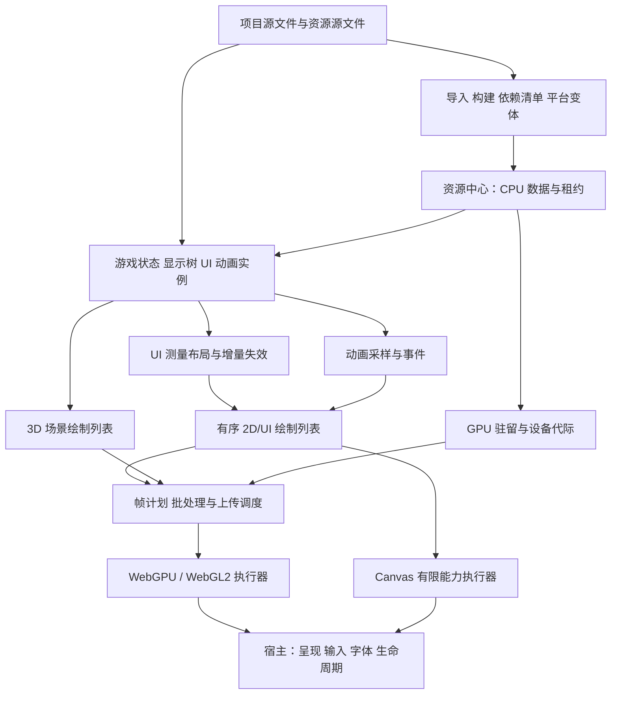
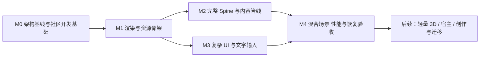

# 白鹭引擎整体架构与工程计划

[English](../../en/docs/architecture-and-engineering-plan.md) | 中文

2026-10-17 · 计划版本 5 · M0–M4

实现基线为主干 `030a34646774dea6c46cc947b55186da9265a6c8`（工程预览 0.61.0）。本计划定义目标架构、代码取舍、依赖与验收，不表示这些能力已实现。M0 首批基础设施已通过 PR #51 合并为主干 `26136df66a493eb721e0780148de4bdc8ed4fb87`。公开看板与新人技术复演在此基础上继续推进，新引擎功能开发仍暂停。[M0 交付记录](m0-community-foundations.md)分别列出已验证基础设施、真人/设备限制及未完成工程验收。

选定环境固定 Node 26.7.0、pnpm 11.25.0、TypeScript 7.0.2 和 PowerShell 7.6.5。历史证据保留原环境；当前检查与浏览器工具迁移状态见 M0 记录。

M0 贡献工具现将内容/声明与维护者生成的当前账本分离；CI 针对明确的 PR 基线检查集成，不授予分支写权限。四个当前浏览器套件已有 Node 26.7.0 入口；固定 Node 24 实验保留历史身份，进阶源码/快照工具仍有独立迁移义务。按风险缩减合并测试尚未启用，完整检查继续执行。剩余 M0 决策与验收完成前不恢复新引擎功能开发。

## 1. 目标、范围与取舍

目标是交付一个能够承载复杂界面、完整版本化 Spine 动画、序列帧动画以及后续轻量 3D 的独立引擎核心。主要用户仍是借助 AI 创作游戏的新创作者；开发者接口保留 Egret 熟悉的显示、事件、资源和时间概念。

本轮主线是渲染性能、复杂 UI、完整 Spine、资源管线。验收单位从狭窄实验改为完整使用场景。性能必须与视觉、交互、动画事件和资源生命周期同时成立，不能通过删减效果或忽略错误获得。

社区协作是实现上述目标的工程基础。项目必须能够由不依赖维护者本机状态的开发者构建、验证与贡献；共享元数据的维护成本不能随并行功能数量不断放大。降低参与成本与保留质量标准通过明确分工和自动化同时实现。

选择“保留公共语义、替换内部执行路径”的渐进重构：

| 方案 | 结果与代价 | 选择 |
| --- | --- | --- |
| 在全部现有执行路径上继续叠加功能 | 短期局部改动少，但重复帧准备、多条入口和资源重复工作会继续累积 | 不作为主线 |
| 保留语义和已验证生命周期，重构执行与资源调度 | 可复用已有资产，允许通过对照路径验证优化；需要明确接口迁移和预算边界 | 推荐 |
| 重写全部核心并同步扩展原生、桌面与编辑器 | 扩大风险与交付面，丢失已经验证的行为，难以快速完成核心产品 | 不采用 |

本轮不展开完整编辑器、Agent 工作台、原生 SDK、Steam、全量 3D 和旧工程一键迁移的实现。它们仍属于总体产品目标；项目标识、构建清单、诊断和兼容样例必须提前为这些能力留下接口。完整迁移 R008/V006、Spine R020/V020 等既有要求不因阶段收敛而删除。

## 2. 现状与工程判断

已具备显示树、坐标与边界、基础 Canvas/WebGPU、纹理网格、九宫格、资源共享与租约、Scope、显式时间、序列帧、基础文字、鼠标输入和资源替换。有限桌面浏览器链路已实际运行。Spine 仍是受限实验；3D 仍是有限几何与场景合成；`@egret/runtime` 是 TypeScript 核心，不是新的原生 Runtime SDK。

源码显示，当前帧捕获仍进行树遍历和对象构造，纹理路径有两轮遍历；WebGPU 提交中仍存在逐绘制项缓冲分配和上传；图像驻留按图像与裁切区域复用。0.61.0 的缓存不等于完整性能体系，也未完成新的专用缓存浏览器矩阵。这些是优化候选依据，不是性能测量结论。

现有生命周期、图像顺序和原始证据继续作为回归基础。新的规模、平台、恢复和性能验收必须重新建立，不能把历史通过记录扩大成新架构已经通过。

## 3. 总体架构与职责

### 3.1 权威状态和边界

- 项目文件保存可编辑内容、稳定 ID、引用和版本；构建产物可重建。
- TypeScript 游戏与实例层拥有游戏状态、显示层级、动画状态和事件。GPU 数据是派生数据。
- UI 布局拥有测量和布局结果；渲染器不通过 GPU 回读决定正常命中或布局。
- 资源中心拥有共享数据与需求；GPU 驻留管理器拥有设备资源和完成等待。CPU 租约释放不代表 GPU 工作已经完成。
- 宿主提供输入、IME、字体、网络/文件、呈现与前后台生命周期。浏览器验证不能代替小游戏或原生 SDK 验收。
- AI 使用项目命令、诊断与可回滚事务，不进入逐帧权威循环。

### 3.2 模块组织

先保留现有四包结构，按职责整理内部模块，不立即增加大量公共包：

| 位置 | 目标职责 |
| --- | --- |
| `packages/contracts` | 小型共享数据契约、能力描述、错误与版本；不依赖其他产品包 |
| `packages/runtime` | 显示状态、事件、Scope、资源租约、基础动画数据；仅依赖 contracts |
| `packages/engine` | 时钟、UI/动画编排、增量渲染准备、帧计划；浏览器执行器保持可选入口 |
| `packages/project` | 项目事务、资源导入与构建清单、依赖诊断和迁移规划；不执行游戏循环 |
| 可选 Spine 适配层 | 显式第三方语义运行库、Egret 资源/实例/渲染适配；默认入口不隐式加载 |

逻辑模块不等于新增公共导出。现有 engine → runtime/contracts、runtime → contracts 的依赖方向保留；project 的导入产物通过数据契约交给运行时，运行时不反向依赖构建工具。新增 UI 与 Spine 包只有在边界稳定、体积和使用方式需要时再独立。

## 4. 渲染性能架构

### 4.1 增量更新与帧数据

显示树仍是开发者操作入口。内部以结构、变换、布局、几何、外观、裁剪和资源绑定的修订号记录失效。合并同一帧重复写入；祖先变化只使依赖它的子树失效。移除和重挂接必须更新绘制顺序、命中与旧缓存。

帧调度顺序为：应用输入及明确的业务更新 → 推进游戏时间与动画事件 → 解析样式/测量/布局 → 更新变换与裁剪 → 准备有序绘制列表 → 资源准备与上传 → 提交。调度期间新产生的修改进入有界后续处理；循环布局给出对象路径和错误，不允许无界重试。显式手动时钟与捕获接口继续可用。

内部使用可复用的渲染记录、紧凑数据和有限临时内存；全量更新保留为正确性对照和高脏比例的可选执行路径。是否切换由测量决定，不承诺固定阈值。公开保存帧维持不可变语义，通过版本化不可变数据块共享资源；复用的可变临时存储不得被已保存帧引用。活跃渲染帧与调用者长期持有的调试快照分别计量，后者不会被引擎静默失效。

这不是简单删除现有全树检查：边界校验、存量规模计数、结构失效传播和调试全量对照共同承担原有不变量。新路径必须证明隐藏节点、祖先变化和资源失效不会绕过限制。

### 4.2 有序批处理与 GPU 内存

先生成稳定的绘制顺序，再合并相邻兼容项。批处理键包括目标、管线/材质、纹理绑定、采样、混合、裁剪及必要颜色状态。禁止跨不兼容项进行全局纹理排序。Spine slot、透明 UI、遮罩和离屏合成都是顺序边界。

静态几何持久驻留，动态顶点与实例参数采用有界分块缓冲池或环形缓冲。实际 GPU 完成之前不得覆盖旧区间。绑定与管线按完整键复用；失效由资源代际和设备代际驱动。预热之后，不变场景应停止纹理和几何重复上传，不能以每个绘制项创建 GPU 缓冲作为常规路径。

渲染目标和深度缓冲按尺寸、格式、采样和用途复用。初期使用少量固定帧计划：普通 2D、带遮罩/滤镜的 UI、3D 加覆盖层。只有真实场景需要时才扩展通用图系统。滤镜和缓存层按像素面积计入预算，不能只按对象数计量。

### 4.3 纹理、色彩与后端

图集以页资源驻留，子图以区域和 UV 引用；trim、旋转和九宫格保留逻辑尺寸。独立小图可以继续独立驻留，不强制全部合图。页方案需要边缘扩展、采样和 mip 策略，避免相邻区域渗色。资源管线决定变体，渲染器不在每帧重新裁切完整源图。

明确纹理用途、颜色空间、预乘方式、采样、mip 和混合公式。新版本采用明确的线性合成配置；对旧 encoded-premultiplied 行为保留版本化兼容配置和图像回归，禁止无说明地改变所有现有像素。Spine 资产的 alpha、双色和 blend 约定在适配层与材质配置中显式映射。

推荐 WebGPU 为主执行器、WebGL2 为首个兼容执行器；两者共享上层绘制与资源语义，各自管理 API 资源。Canvas 保留已有基础能力与文字栅格服务，不承诺完整 Spine、网格与滤镜降级。启动时选择并验证能力配置；缺少必要特性应在构建或加载阶段明确拒绝。运行中更换后端必须重建资源与重新验证，不允许悄悄删减效果。

## 5. 复杂 UI 架构

建立 UI 组件、样式/皮肤、测量与布局、滚动/虚拟化、输入焦点、文字六个协作模块。组件复用显示树与 Scope，不另建一套资源所有权。

首批完整范围：容器、文本、图像、按钮、切换/选择、滚动容器、虚拟列表、弹层、基础文本输入；布局支持显式尺寸、约束和横纵布局。自动布局有确定的测量/放置阶段、最小/最大尺寸规则和循环检测。基础皮肤包含默认、悬停、按下、禁用和焦点状态。旧 EXML/EUI 完整兼容留在迁移阶段，不能把新 UI 完成等同于迁移完成。

虚拟列表只实例化可见区及固定预取区。复用项必须解除旧数据、监听与异步资源需求；变高行重新测量时保持滚动锚点。命中与绘制使用同一份已提交布局、变换和裁剪版本。手动 hitArea 保留；UI 组件可依据其已提交布局生成明确命中区域，不以像素自动推导交互。

文字管线将测量/排版、栅格和显示分开。缓存键涵盖文本、字体与回退代际、尺寸、样式、语言、方向、约束及密度。先用宿主文字能力完成一致的测量与栅格路径；字形图集仅用于验证过的脚本与组合，不按 UTF-16 单元拆分阿拉伯文、组合字符或 emoji。自动换行、对齐、截断和富文本必须有固定参考样例。

输入以 pointer 语义统一鼠标与触摸，支持捕获、取消、滚动、焦点与键盘。文本输入通过宿主 IME/原生输入桥接，明确光标、选区、组合输入与缩放坐标；前后台或焦点丢失必须结束相关捕获。浏览器语义桥接为控件提供名称、角色、状态与基本键盘访问；未验证的宿主可访问性明确列为缺口。

## 6. 完整 Spine 与动画架构

完整 Spine 按“精确导出版本 × 对应运行库 × 特性 × 后端 × 宿主”验收。0.61.0 实验使用的 Core 4.3.13 仅是现有输入，不因本方案自动成为正式支持版本。M0 冻结首个稳定版本及确切输入；后续版本独立登记。首个版本范围内必须完成全部适用特性，不能用受限 profile 宣称完整支持。

继续采用明确第三方身份的官方语义运行库，Egret 独立实现加载、实例、时间/事件、渲染、UI 集成、诊断和恢复。运行库及素材出处、版本与分发条件在接入阶段记录；本方案不新增或重新许可第三方代码。

共享层保存不可变骨架与多页图集数据；每个实例单独拥有姿态、skin/attachment、轨道、混合、约束、physics 状态与监听。借用同一素材的实例互不污染。播放控制统一游戏时间语义，但不把 Spine、Tween 和序列帧强行塞进同一种采样算法。

动画更新分为状态/事件推进与视觉采样。不可见或降采样不能随意丢失业务事件；seek、跳帧、暂停、循环、切换与恢复采用明确事件策略。长时间后台恢复重建时间基准，不无界补帧；已经消费的奖励/事件不重放。

图形集成必须覆盖选定版本的全部附件、约束与时间线，并验证网格变形、裁剪及该版本适用的反向裁剪、light/dark tint、混合模式、透明边缘、slot 顺序和多页采样。不得通过独立 Canvas 播放器绕过 UI 层间合成。挂载对象、命中边界、负缩放、重挂接、换装、设备恢复一并进入场景验收。

对照采用版本正确的参考导出、离散事件预期和独立图像参考。共享同一个官方语义运行库的两条路径不能相互证明动画算法正确；需核对作者预期和外部参考输出。序列帧补齐 seek/rate/事件/有限循环，Tween 补齐组合与属性编排；DragonBones 保留独立后续适配，不伪装为 Spine 兼容。

## 7. 资源管线与恢复

| 层 | 权威内容 | 生命周期与预算 |
| --- | --- | --- |
| 源与构建产物 | 稳定资源 ID、源哈希、导入设置、工具/格式版本、目标能力、依赖和素材来源 | 可重复构建；派生缓存可删除重建；产物按内容定位 |
| CPU 数据 | 解码图片、字体/布局数据、动画/模型共享数据 | 租约与依赖引用；任务/解码/驻留分别限额；可选择保留恢复所需数据或重载配方 |
| GPU 数据 | 纹理页、网格、缓冲、管线、渲染目标 | 设备代际、使用完成等待、驻留/在途/临时预算；释放和重建由 GPU 管理器负责 |

构建产物必须记录源依赖与反向依赖；同样输入、工具、设置和目标得到相同规范清单及受控产物哈希。无法确定化的工具必须记录非确定字段和范围，不能宣称全链路逐字节确定。首次构建、增量构建、缓存命中和失效分别计量。

内容导入首批覆盖普通图片、单页/多页图集、序列帧、Spine JSON/二进制及字体清单。压缩纹理、mip 和平台变体在相应能力配置下构建；不支持的资源不得静默换成不同效果。3D 模型数据接口保留扩展，完整导入在后续 3D 阶段完成。

加载调度提供依赖展开、循环/缺失检查、优先级、公平队列、并发/字节预算、取消、超时与有界重试。网络、解码、上传分别调度，避免“大资源加载完成”一次性阻塞交互。共享依赖只释放当前需求，迟到结果按代际处理。

资源替换分成 CPU 准备、指定设备的 GPU 就绪、绑定提交、呈现确认。新场景级替换事务在必要依赖全部就绪后提交；失败保持旧内容，并释放候选。现有 Bitmap ticket 的 CPU 提交语义继续保留，不能悄悄升级成等待 GPU 的异步方法。只读预加载不占有显示绑定。

设备丢失：关闭旧提交入口 → 标记旧设备代际失效 → 保留游戏/实例权威状态 → 建立新设备/能力配置 → 从 CPU 数据或清单重建资源 → 恢复提交。重建中的旧异步结果不得进入新设备；无法恢复时给出可重试错误和明确状态。必须记录恢复时间、下载/解码/上传成本，不能只验证一次成功绘制。

## 8. 现有代码处置清单

“保留”指语义与实现资产优先复用，仍需通过新组合的回归；“重构”不授权当前立即修改。

| 当前位置或能力 | 处置 | 理由与迁移边界 |
| --- | --- | --- |
| runtime 的 `Scope`、`Event`、`EventDispatcher`、取消与错误基础 | 保留 | 生命周期和事件基础有效；避免引入第二套清理规则 |
| `AssetManager`、`AssetLease`、`AssetRef` | 保留语义，扩展调度与依赖 | 不改变已有独立取消、共享加载、代际和最后释放规则；缓存有明确持有者 |
| `DisplayObject`、容器、Stage、坐标与边界 | 保留公共概念，重构内部失效 | 新布局和渲染缓存不得改变层级、变换和坐标语义 |
| `Texture`、`Bitmap`、`Mesh2D`、SpriteSheet、AtlasFrameLayout、NineSliceBitmap | 保留语义，扩展数据引用 | 裁切/trim/旋转逻辑与资源所有权保留；页驻留不改变作者坐标 |
| `frameCapture.ts`、`texturedFrameCapture.ts`、渲染准备/打包模块 | 重点重构 | 分离校验、增量状态和执行数据；旧全量路径在迁移期间作为有范围的对照 |
| `WebGPUHost.ts`、image/mesh/pass 与投影模块 | 拆分职责并重构 | 会话生命周期、驻留、上传、缓冲、帧执行和诊断独立；正常热路径去除逐项分配 |
| 0.61 图像驻留缓存 | 保留已验证回收原则，替换具体缓存模型 | 从裁切驻留走向页/独立纹理统一管理；不把 32 MiB/256 条目当所有设备的永久产品规格 |
| `CanvasHost` | 保留有限能力后端 | 不通过静默网格近似扩展能力声明 |
| `TextRasterCache`、TextField、CanvasTextRasterProvider | 保留所有权与异步替换，重构测量/排版连接 | 当前显式行接口可继续使用；新文本布局不能误用旧缓存键 |
| `planLinearLayout`、MouseInput、BitmapButton | 保留工具和兼容入口，新增完整 UI 层 | 线性规划器不是自动布局；鼠标接口适配统一 pointer 体系 |
| gameClock、Tween、SequencePlayer/Playback | 保留时间语义，扩展控制与编排 | 帧捕获不推进时间；新的 seek/event 行为显式版本化 |
| BitmapResourceSlot、AssetGroup、BitmapBindingTicket | 保留，作为高层事务基础 | GPU 准备和场景事务使用新编排，不改写现有同步承诺 |
| project 的 atlas/spine 预检与事务 | 保留严格输入与诊断，接入完整构建 | 导入规划成功不能直接当作像素、动画或分发验收 |
| `knowledge-base/experiments/spine-*` | 保留历史参考和回归素材，替换实验适配入口 | 正式适配重新设计实例与特性覆盖；不可直接解除实验数量限制就称完整 |
| Matrix4、有限 scene3d 与混合场景代码 | 保留并冻结非必要扩张 | 用作混合合成回归；完整模型/材质/角色另有阶段 |
| 公共行为测试、参考图像、原始证据、来源记录 | 保留 | 接口变化时明确继承/新增/淘汰关系；不重写历史 PASS 或原始哈希 |
| 过细实验入口、重复协议分支、当前文档里的历史状态拼接 | 有迁移说明地合并整理 | 不能一次性删旧接口或来源；精简的是组织负担，不是验证标准 |
| 工具链入口、环境检查、版本声明与安装文档 | 在 M0 统一 | 当前 Node 26.7.0 安装与基础检查不代表全部工具迁移完成；消除未说明的本机路径和依赖别名 |
| 跨功能全仓指纹与模块清单检查 | 在 M0 明确并实现职责拆分 | 开发检查依赖契约与实际影响闭包；全仓结构集中检查；执行证据仍绑定真实输入 |
| source-origin/localization、版本与登记册的集中维护 | 在 M0 建立受控生成与集成流程 | 贡献者提供来源和必要说明；维护方生成当前账本并核验，历史记录不重算 |

公共 API 变更用集中清单记录旧/新入口、语义差异、自动替换能力和回归样例。预览阶段允许必要的不兼容调整，但必须显式版本化；新旧路径只保留到约定迁移门禁通过，不永久维护双份执行器。原有仓库规则与边界检查若需改变，应随正式重构一起评审修改，本规划不自动豁免它们。

## 9. 工程阶段、依赖与退出标准

只设置五个主里程碑。每个里程碑允许若干可审查 PR，但共用一份规格、一组场景和一份阶段验收；不为每个辅助类型、转发函数、校验器重新建立独立实验工程。

M2/M3 可并行，但共用 M0 确认、M1 实现的纹理视图、材质、裁剪、资源代际和时间契约；不允许各自另建 GPU 管理器。M0 的 Spine 素材与 UI 用例必须先进入 M1 设计，避免先冻结底层再发现上层无法表达。

M0 同时关闭架构基线与社区开发基础门禁，不要求新渲染架构性能已经达标，但环境、CI 和贡献流程必须实际可用。目标设备暂不可获得时，可以先固定设备身份、候选预算和后续测试方法，再推进 M1；该设备的实际验收继续阻塞 M4 的对应支持声明。不能以设备不足为由豁免可执行的开发环境与 CI 检查，也不能只写“以后决定设备和预算”就宣布 M0 完成。

| 阶段 | 完整交付物与依赖 | 退出标准 |
| --- | --- | --- |
| M0 架构基线与社区开发基础 | 输入当前主干、授权素材和本规划；输出场景/支持矩阵、接口迁移与预算表、统一环境入口、公开 CI、贡献分级和账本流程、新人指南与路线图 | 旧能力可复现；Spine 全集与设备预算固定；下述 M0 验收表全部通过；新贡献者可从干净克隆运行并提交无需手工维护全仓账本的 PR；未执行的设备项不计通过 |
| M1 渲染与资源骨架 | 依赖 M0；交付增量显示、相邻批处理、页纹理、缓冲/目标复用、能力配置、最小构建清单和设备重建机制；贯通带文字、图集动画、裁剪和替换的场景 | Canvas 既有行为无未解释回归；WebGPU/WebGL2 在共享特性样例中符合预设图像参考；静态/稀疏/全脏正确；热态不重复上传不变纹理/几何；完成等待与预算压力下不复用在途资源；实际可用浏览器的丢失/重建通过 |
| M2 完整 Spine 与内容管线 | 依赖 M1；交付正式可选适配、多页与平台资源构建、共享实例、完整播放事件、序列帧控制、加载调度与场景替换；Spine 位于真实 UI 层间 | 首版本所有适用特性有结果，必需项不得 skipped；JSON/二进制与多页路径可复现；轨道/事件/约束/像素符合参考；实例隔离、换装、取消、热替换与恢复通过；增量构建与缓存失效可验证 |
| M3 复杂 UI 与文字输入 | 依赖 M1；使用 M2 共享接口但不等待全部动画功能；交付组件、自动布局、皮肤、变高虚拟列表、富文本、输入与 IME、焦点和基础可访问性 | 固定大界面样例中的布局、命中、滚动锚点、控件复用、输入组合、字体变化、缩放和后台恢复通过；静态无重复布局/栅格；局部变化不无理由使整树失效；文字参考与性能均有记录 |
| M4 混合场景与核心验收 | 依赖 M2/M3；把复杂 UI、Spine、序列帧、资源替换及已有有限 3D 场景合成一套可编辑示例与报告 | 完成功能矩阵、目标性能预算、持续运行、资源循环与实际设备/宿主行；包体和首次交互测量完成；未通过必需行不得称生产就绪；发布当前能力清单、迁移说明和英中文档 |

阶段内部的工作角色为渲染/性能、资源/构建、UI/文字、动画/Spine和独立验收。角色可由同一维护者承担，不能据此假设已存在人员或承诺并行工期。每项共享接口有一个维护责任人；跨模块变更统一评审，不能通过复制实现回避依赖。

### 9.1 M0 的完整交付与验收

本表是同一里程碑的验收维度，不是新增实验项目。M0 使用一份规格和结果报告；环境、CI、文档与验证规则的修改可以按完整行为分为可审查 PR。

| 验收维度 | 交付要求 | 必须留下的实际结果 |
| --- | --- | --- |
| 架构与场景 | 保留原有场景包、Spine 特性全集、宿主/设备矩阵、预算和 API 迁移表 | 每项核心目标有场景与验收归属；目标预算已冻结；缺少设备的行明确列出，不伪造执行结果 |
| 环境统一 | 当前开发与 CI 固定 Node 26.7.0、pnpm 11.25.0、TypeScript 7.0.2；明确 PowerShell 7 的选定版本和安装范围；记录依赖布局及必要别名的生成方式 | 干净 Windows 克隆按公开步骤完成安装、构建、核心检查和示例；记录父子进程实际版本；无需个人缓存、私有工具路径或手工补别名；重复准备不会破坏工作区，检查模式不写入 |
| 公开验证 | Windows 公开 CI 运行干净安装、构建、类型、行为、边界及文档检查；明确必需检查和结果留存；建立开发平台支持矩阵 | PR 与集成候选有可查看、绑定提交的检查结果；注入一个普通行为回归或依赖越界会阻止通过；Linux/macOS 各执行所声明的无宿主 CPU 测试集合，记录实际通过范围和未支持检查；不得据此声称这些平台的图形能力已通过 |
| 并行贡献与账本 | 贡献输入与集中发布元数据分开；实际依赖闭包检查、集中结构检查和受控账本生成各司其职 | 两个独立分支完成无关改动，不必手工修改同一集中账本；维护方集成后可确定生成并通过检查；修改真实依赖或越界仍会被检测；生成后再改输入会使验收失效 |
| 社区入口与阅读 | 简短架构/首个 PR 指南、能力首页、M0–M4 公开路线图、贡献分级、评审与合并职责、可兑现的响应安排 | 一位未参与环境搭建的开发者按文档完成运行与一次 PR 提交流程；找得到范围、依赖、状态、验收和评审入口；英中文档齐备。若暂无外部参与者，独立干净环境复现可先通过技术项，但人类新人验证仍保持未完成 |

M0 的环境迁移需要逐项盘点活跃指南、脚本、断言和采集工具中的旧 Node 限定。当前使用的工具迁移到新基线并重新验证；仅用于历史复现的工具明确标注并保留旧环境。不能全局替换旧版本号，也不能通过删除版本检查宣布兼容。依赖布局如暂需 hoisted 或特定别名，应公开、自动化并经干净安装验证；长期目标是验证真实依赖身份而非维护者机器的偶然目录布局。

M0 内部顺序为：冻结支持环境与检查分层 → 统一准备和工具入口 → 建立公开 CI 与受控账本集成 → 完成新人流程演练。架构/场景与贡献指南可同步整理；必须先有实际可复现步骤，再把 CI 当作合并依据。平台无关测试不得静默跳过到只剩空集合；M0 预先列出集合及平台排除理由。

M0 关闭后，M1–M4 沿用同一协作与验证机制，不各建一套账本或脚手架。公开在线示例和可安装预览包按后续能力成熟度推进，M0 先确定展示与发布规则，不以稳定版发布作为上手修复的前提。

### 9.2 三个交付包及依赖

三个交付包是 M0 的实施组织，不是新增里程碑；继续共用第 9.1 节的验收表。架构、Spine 全集、设备与预算冻结仍是 M0 的必要工作，不能被社区建设取代。以下入口和文件是拟定交付目标，不表示仓库已经提供这些能力。

| 交付包 | 责任与依赖 | 完整交付 | 退出标准 |
| --- | --- | --- | --- |
| A 能够独立上手 | 工具链维护与文档维护负责；依赖环境及可运行示例基线确认 | 统一版本、环境诊断、可重复安装、快速开始、可视示例与常见故障说明 | 干净 Windows 环境按公开步骤构建并运行示例；图片、动画、文字和交互符合说明；改动一个已说明的参数能看到预期变化；错误版本、缺失工具或不支持后端提供可操作诊断 |
| B 能够顺利贡献 | 集成维护负责、相关模块参与评审；依赖 A 的相同命令及版本；C 提供评审入口 | 简短 Issue/PR 模板、风险分级、局部与合并检查、共享元数据集成、公开 CI 和主干保护 | 外部 fork PR 能进入明确的验证流程；两个无关贡献无需手改同一集中账本；故意引入的回归与依赖越界分别阻断；修复后的最终候选通过且绑定同一输入；必需检查失败不能合并 |
| C 能够持续协作 | 社区与文档维护负责；入口可与 A 并行准备，最终依赖 B 的实际 PR 流程 | 首页导航、双语新人指南、Discussions、M0–M4 公共看板、维护责任及响应安排、新人完整演练 | 一位未参与搭建的开发者完成运行、修改、验证、提交和获得评审；可找到任务范围、依赖与维护人；全过程阻碍有记录并修复或明确保留为未完成 |

A 的可视示例优先复用 `examples/resource-scene/` 已有的有限行为，补齐启动与修改说明；不借上手改造扩展引擎功能。若现有示例无法在声明环境运行，记录具体缺陷和所属工程范围，不能通过伪造画面或删去必需步骤关闭 A。

### 9.3 实施入口与文件归属

| 归属 | 拟修改或新增的位置 | 规则与交付接口 |
| --- | --- | --- |
| A 环境与工具 | `package.json`、`.node-version`、`.nvmrc`、活跃检查工具；新增 `tools/doctor.mjs`、`tools/setup-dev.mjs` | Node、pnpm、TypeScript 分别以 package 的 engines、packageManager、精确依赖声明为权威，其他版本入口检查一致性；PowerShell 在环境指南声明精确版本及安装范围。提供 `pnpm doctor`、`pnpm setup:dev`、`pnpm example:browser`；doctor 只读，setup 可重复且不覆盖用户改动 |
| A/C 上手与导航 | `README.md`、`README.zh-CN.md`、`CONTRIBUTING.md`、`CONTRIBUTING.zh-CN.md`、`DOCUMENTATION.md` 及其中文配对；复用 `examples/resource-scene/`；新增 `knowledge-base/en/docs/getting-started.md` 与 `knowledge-base/Cns/docs/getting-started.md` | 首页保留创始人介绍和精简近期 Changelog，前置能力、限制、运行与贡献入口；新人页包含预期画面、可修改位置、故障处理和首个 PR；不复制全部历史记录 |
| B 检查与集成 | `tools/verify.mjs`、`tools/prepush.mjs`、`.githooks/`、现有元数据检查/生成工具、`AGENTS.md` 及中文配对 | 提供 `pnpm check:quick` 和 `pnpm check:merge`，CI 调用同一实现；快速检查不能仅按文件名漏掉消费者；贡献检查与最终账本验收分开；源声明人工评审，当前元数据受控生成，历史证据只读 |
| B GitHub 文件 | 新增 `.github/ISSUE_TEMPLATE/` 下的缺陷、环境、建议表单及 `config.yml`；`.github/pull_request_template.md`、`.github/CODEOWNERS`、`.github/workflows/ci.yml` | 模板用简短英中文提示，允许任一语言填写；不强制提交完整私有工程或无关性能报告。CODEOWNERS 仅列真实具备权限的维护者；CI 结果可追溯到候选与实际执行域 |
| C 协作内容与远程设置 | 在双语 CONTRIBUTING 内维护职责、评审响应与延期处理；GitHub About、Topics、Discussions、Project、Milestones、Rulesets | 使用一张公共看板和 M0–M4；文档链接到同一状态来源，不手工维护另一份进度。仓库文件与后台设置分别记录；提交配置文件不等于远程设置已生效 |

`pnpm doctor` 需报告实际工具版本、父子进程版本、工作目录/权限、依赖布局以及后续修复命令，不输出凭据或个人配置。检查模式不安装、不改 PATH、不改文件。安装入口说明所需网络和作用范围，不替换系统全局工具；缓存仅作加速。Windows 含空格及中文路径、LF 与 authored-case 文件键进入 A/B 的验收，不能靠手工改目录或重算历史指纹绕过。

本轮不直接替换既有 hooks。B 在受审查的迁移中调整日常提交成本：本地快速检查负责及时反馈，最终候选执行合并检查和适用浏览器验证；当前规则在迁移通过前保持有效。新增入口必须有清晰成功、失败及未执行状态，不能把环境不支持显示为通过。

### 9.4 GitHub 改造的执行顺序

下表按依赖执行。入口内容可以提前准备，但正式启用主干阻断必须等待 CI 已验证。执行时先重新读取远程状态，保留已有配置并审查差异；本计划不把先前快照当作永久事实。

| 顺序 | 操作及前置条件 | 验收与失败处理 |
| --- | --- | --- |
| G1 基线与责任 | 记录 main SHA、现有规则、Actions、权限和社区设置；确认环境版本、检查分层及维护角色 | 有设置前后对照的保存位置和变更责任；缺失维护者或权限记为阻碍，不冒用管理员身份 |
| G2 上手与贡献入口 | 完成 A 的干净安装；整理首页、双语指南；提交 Issue/PR 模板；准备 About、Topics 和导航 | 新人无需私下路径说明即可运行；三类表单可用且字段最少；README 链接有效；文档初稿允许单语，主干交付双语齐备 |
| G3 公开 CI 与集成 | 使用 A 的入口，实现 B 的验证与元数据集成；在测试 PR 和明确基线上试运行；此时不提前要求尚不存在的必需检查 | 干净安装不依赖缓存；Windows 开发检查、Linux/macOS 声明的 CPU 集合实际执行；外部 fork 的待批准状态可见并有负责处理的人；故障日志可定位，必要结果按第 9.5 节阻断 |
| G4 保护与评审 | G3 的检查名称及行为稳定后，配置 main Ruleset、CODEOWNERS 和评审职责 | 要求 PR、必需检查与讨论解决，禁止强推/删除；在临时分支使用等价规则验证允许与拒绝路径，再读取 main 的实际生效规则；不在 main 注入破坏。绕过权如有必须最小化并留痕 |
| G5 公共协作 | 启用 Discussions，建立一张 Project 看板及 M0–M4 Milestones，补全已知能力条目的验收和维护人 | 问答、设计、作品与公告各有入口；Issue/PR 能关联里程碑和看板状态；`good first issue` 必须有代码入口、预期行为、验证方式及评审人；已标记可认领的项目不能缺少这些条件 |
| G6 新人完整演练 | A/B/C 入口均可用；由未参与环境搭建的开发者从干净克隆开始，在 fork 上提交一个真实、范围明确的改进 | 完成运行 → 修改 → 本地检查 → PR → CI → 评审；维护方补齐双语与集成材料后，通过最终候选检查再合并。分别记录操作、下载、排队和反馈耗时；若无参与者则保持该项未完成 |
| G7 展示与发布衔接 | G6 后整理发现与修复；明确文档/示例部署和预览包发布条件 | M0 交付 Pages/Release 的配置方案与验收规则；实际网站、在线示例或可安装包只有在部署/消费验证后才声明可用，依能力成熟度归入后续里程碑，不作为已发布成果 |

G5 的文案和看板结构可以与 G2 并行准备；G6 必须等待 G4 的合并流程和 G5 的维护入口可用。Discussions 接收问题与方案，Issues 跟踪确认的缺陷和工作，PR 承载修改；维护者帮助分流，不因新人分类不准确拒绝贡献。Project 展示状态，Milestones 对齐阶段，规格定义验收，三者互相链接。

评审规则按实际人员配置：核心变更需要独立的技术评审；AI 审查与 GitHub 人工审批分别记录，不能互相冒充。强制人工审批数及 CODEOWNERS 的阻断要求，需在确认有可响应、具备权限且不是 PR 作者的评审者后启用；缺少独立评审的核心 PR 保持待审，不因仅有一位维护者就自动放行。评审响应目标和延期安排在 G1 确定，并在 G6 核查实际表现，不预设虚构服务承诺。

### 9.5 CI、保护规则与失败验收

CI 对外保留稳定的最终检查名 `M0 / merge-ready`。它始终执行并汇总环境、构建、行为、边界、来源、双语及适用浏览器检查，不能只靠工作流成功启动或上游 job 被跳过就通过。平台专用检查分别报告；实际运行的命令、集合、环境和提交必须可查。必需工作流不通过路径过滤整体跳过；文档等低风险修改可由明确的适用性规则免除无关 GPU 工作，但不得省略应执行的回归。

检查结果绑定候选树、基线、工具/依赖和适用测试域。代码、共享元数据或基线变更后重算影响并复验；重新生成哈希不是通过。启用 Ruleset 时固定实际产生结果的检查来源；最终候选与合并结果不同则重新验证，不能复用另一份树的绿色状态。

| 验收路径 | 必须观察到的结果 |
| --- | --- |
| 正常贡献 | 外部 fork 的普通 PR 在获准运行后完成检查；维护方集成和补齐双语后的候选可合并；首次外部贡献的批准等待单独显示 |
| 回归与依赖错误 | 分别注入行为回归、跨包禁止依赖，相关检查及最终检查均失败；修复后相应检查重新运行；错误候选不能合并 |
| 元数据失效与并行贡献 | 两个无关分支不手改同一集中账本；集成生成确定且可复现；生成后修改真实输入被检出；历史记录字节保持不变 |
| 缺失、取消与跳过 | 必需检查缺失、取消、失败或必需集合未执行时，最终检查不能通过；不适用项须有可审查规则与原因，不能静默变成空测试集 |
| 权限与规则生效 | 不受信任 PR 不获得仓库写权限或发布凭据；受信任集成操作与其执行隔离；规则演练阻止无检查合并、强推及删除，并允许合格候选进入正常流程 |
| 路径与文本 | Windows 空格/中文路径及声明的平台路径可复现；新文本符合 UTF-8、无 BOM、LF 和单尾换行；authored-case 文件键变化可发现；物理路径归一化不改写证据身份 |

公开结果包括检查链接、输入身份、执行范围和必要日志；含个人路径或敏感值的日志先脱敏，不能上传密钥。G3 确定并公开结果留存期，阶段验收保留可长期访问的摘要与必要证据，避免只依赖会过期的 CI 附件。GPU、手机和小游戏能力仍需各自实际执行结果，通用 CI 不代替这些验收。

### 9.6 M0 汇总验收与边界

M0 使用同一份中英文结果报告，按 A/B/C 和 G1–G7 建索引，记录责任角色、候选 SHA/树身份、命令、环境、检查链接、规则回读、失败反例、未完成项和复验结果。执行前为 A 的安装与示例、B 的快速与合并检查、C 的评审响应设定可兑现的时间目标；演练分别记录主动操作和外部等待时间。时长目标是流程改进依据，不能通过省略检查达成。

关闭 M0 必须同时满足第 9.1 节的架构/预算条件、A/B/C 的退出条件以及 G1–G6 的实际验收。G7 在 M0 的退出要求仅为明确、可审查的展示与发布方案；未部署网站或未发布包不得标为已上线。独立评审与新人演练缺失时，明确保留对应未完成项；计划自审、CI 通过和新增模板数量都不能替代它们。后续 M1–M4 复用该流程，不再建立平行的协作或发布系统。

## 10. 场景与验收规范

### 10.1 固定场景集

以下数量是候选压测规格，不是已有支持上限或实测结果。M0 根据授权素材与目标档位冻结，不得在看到结果后偷偷缩减。

| 场景 | 候选负载与用途 | 主要所属阶段 |
| --- | --- | --- |
| U 复杂 UI | 10,000 逻辑节点、1,000 可见节点、8 层嵌套裁剪；50,000 条变高列表数据；中文/英文/RTL/emoji 文字与输入；静态、1% 变化、全脏三种更新 | M1、M3 |
| A 动画与换装 | 20 个独立 Spine 实例、共享多页资源、不同轨道和皮肤；200 个序列帧实例；完整特性另有小型精确素材，不以规模场景替代 | M2 |
| X 混合内容 | U/A 的约定子集与已有 3D 背景组合，固定透明顺序、遮罩、交互和换装；不能默认把各自最大负载同时相加 | M4 |
| L 生命周期 | 100 次场景进入/退出、取消与资源替换；每个可执行后端 10 次实际图形丢失/重建；前后台/网络故障；30 分钟持续运行 | M1、M2、M4 |

### 10.2 正确性与性能

- 离散行为：事件次数/顺序、资源代际、换装原子性、命中对象、层级顺序必须精确匹配预期。
- 图像：每种场景预先规定检查域、允许差异和参考来源。不能只采少量点却声称整帧一致；字体抗锯齿差异与布局/字形错误分开。
- 优化：与同输入的完整计算参考对照，覆盖静态、稀疏、全脏。旧核心不能表达的新特性使用独立参考，不能用功能缩水的旧版本作为速度基线。
- 热态：相同资源/尺寸/内容的稳定帧不重复布局、不重复文字栅格、不重复上传纹理和静态几何。缓冲池仍可能维护正常命令对象，不宣称 JavaScript 零分配。
- 记录 CPU 的动画、布局、捕获、批处理、上传准备耗时；GPU 时间单独测量，计时能力不可用则记未测，不能用 CPU submit 耗时代替。
- 记录 p50/p95/p99 帧时间、慢帧分布、上传字节、绘制次数与不能合批原因、分配/GC、逻辑驻留/在途/临时字节。物理显存和能耗需专门设备证据，逻辑计数不替代。
- 候选 60 Hz 档目标：稳定负载帧间隔 p95 ≤ 16.7 ms、p99 ≤ 33.4 ms；引擎主线程工作 p95 ≤ 8 ms，其中渲染准备 p95 ≤ 4 ms。GPU p95 ≤ 8 ms 作为独立目标，不把 CPU/GPU 简单相加。这些尚未绑定硬件；M0 必须确认或修订，之后固定验收。
- 30 Hz 档、首包体积、首次交互、CPU/GPU/缓存字节预算、恢复时长与允许回归幅度由 M0 绑定设备、网络、分辨率和内容后给出数值。缺少这些值时 M0 不退出，也不进入正式 M1；可继续素材盘点和设计准备。目标数值已冻结但缺少实体设备时，按照上一节的规则推进可验证工作，设备验收保持开放。
- 测量采用锁定的发布构建、内容哈希、设备/OS/浏览器、分辨率/DPR和网络条件；分别记录冷态/热态，预热 30 秒后至少 5 次各 60 秒采样；长跑单独记录温度/频率和条件。任何采样排除必须预先定义并保留原始结果。
- L 场景清理后逻辑活跃 owner、未完成任务与在途计数回到规定基线；缓存可保留在显式上限内。堆快照/引用路径与趋势共同检查持续增长，不把一次 GC 结果当作无泄漏证明。受控故障验证不能替代实际设备行。

所有阈值与场景版本在执行前固定。若无法达到，应记录原因并通过可见的规格修订调整目标或实现，不得静默降低门槛。

## 11. 验证、评审与文档组织

每阶段一份能力规格、一份场景/验收表、一份结果汇总；细节放入源码与同一测试集合。PR 按可运行行为或职责完整的内部替换组织，不按函数数量划分。M0 需要将本节规则落实到贡献指南、仓库规则、hooks 和 CI，并验证迁移结果。在这项受审查的流程迁移完成前，既有门禁仍然有效；本规划本身不授权跳过它们。

### 11.1 贡献者、集成方与自动化的职责

| 角色 | 负责内容 |
| --- | --- |
| 贡献者 | 范围集中的代码、必要测试、使用/API 说明、兼容影响、来源/依赖及 AI 辅助说明；不要求手工重算全仓指纹和版本登记册 |
| 维护与集成方 | 确定风险等级、评审代码与来源、补齐并审阅双语、准备最终集成候选、处理共享元数据与合并 |
| 自动化 | 按明确输入生成当前清单、指纹和登记视图，运行检查、报告差异；不自动批准来源、设计变化或测试结果 |

来源事实仍由作者声明和评审确认，机器人只能整理，不能推断“原创”或补造出处。贡献草稿可先用一种语言完成评审；项目维护方公开交付及主干合并前，必须补齐中英文说明和关键英文注释。维护者与 AI 的贡献遵循同样规则。

### 11.2 三层验证与风险分级

| 验证层 | 检查范围与执行时机 | 通过的含义 |
| --- | --- | --- |
| 日常开发 | 受影响行为、类型、实际依赖闭包与相关契约；局部迭代时执行 | 本次影响范围得到快速反馈，不代替合并检查 |
| 合并 | 最终候选的完整构建、核心回归、集中包边界、来源、双语和文档；涉及图形时增加对应真实浏览器验证 | 该候选满足明确的合并规则，不等于所有宿主或性能验收通过 |
| 发布与平台 | 绑定产物与输入身份、设备/浏览器矩阵、持续运行、性能、恢复、包与示例验收 | 只建立实际执行的平台、版本与负载范围 |

| 风险等级 | 判断依据 | 必需补充 |
| --- | --- | --- |
| 低风险 | 文案、说明和不改变执行语义的局部工具改进 | 相关检查、清晰差异与必要复现；不要求无关 GPU 实验 |
| 一般功能 | 局部行为、小型 API 或组件变化 | 行为回归、公共契约及适用类型检查；图形受影响时仍需浏览器验证 |
| 核心风险 | 渲染、所有权、异步失效、时间/事件、输入路由或兼容语义变化 | 独立源代码/结果评审、针对性反例、相关浏览器或设备记录 |

等级取决于影响而非代码行数、PR 名称或“Bug 修复”标签；小改动也可能是核心风险。贡献者提出分级，评审方确认，范围变化时重新分级。任何等级均不得跳过来源、必要回归和合并前双语要求；不相关的平台结果不重复收集。

### 11.3 指纹、账本与公开 CI

开发期检查包依赖方向、公共导出、禁止导入和真实依赖变化；不在每个功能工具中复制全仓文件清单。全仓结构规则由集中检查负责，模块验收覆盖实际使用的依赖闭包，不能缩减为只检查本模块文件。发布指纹继续绑定原始字节、工具、依赖和产物。

集成顺序为：评审贡献及来源 → 在明确基线上形成候选 → 生成当前账本与完整双语 → 执行最终检查 → 合并同一候选树。任何输入或基线变化都需要重新确定影响并重跑相应检查。自动重算哈希不是验收；账本生成应具有确定性与检查模式，保持失败状态可见。历史证据、旧环境身份和原始测试记录只读保留，不加入自动刷新目标。

公开 CI 从干净环境执行，与本地使用同一入口和版本声明；缓存只是可选加速，不能掩盖缺失依赖。外部 PR 检查使用最小权限，拥有写权限的账本/发布操作与不受信任贡献执行分开。结果必须绑定提交和输入；CI 没有执行真实 GPU、手机或小游戏宿主时，对应行保持未验证。原始检查结果和失败原因可定位，不能把缺少检查显示为通过。

### 11.4 社区入口、文档与版本

公开路线图沿用五个里程碑，下设少量完整能力入口，每项包含范围、依赖、负责人、验收与状态：讨论中、可认领、进行中、待评审、受阻或完成。不按辅助函数数量创建任务，也不据此指派任何具体贡献者。跨模块公共接口先形成简短 RFC 并与里程碑对齐，再进入实现。

贡献指南写明评审职责、合并权限、响应目标和延期处理；根据实际维护能力制定，不虚构人员或时间承诺。DCO/CLA 如需采用，作为明确的治理决策另行处理，不由本规划自动引入协议或授予权限。

独立评审先看功能、所有权、复杂度与风险，再看结果是否对应实际版本和完整测试域。对异步失效、在途复用、裁剪/混合、布局循环、跨实例动画状态保留必要反例；不为无新增风险的转发层重复建立多轮实验。计划自审不冒充独立实现评审。

当前能力页只保留现状、限制、例子与稳定复现入口。历史执行、失败和修复证据保留原始身份，在归档中引用。每项能力分别标注 implemented、verified scope、remaining acceptance，避免“源码存在”变成“产品完成”。源出处、第三方许可与 AI 辅助归属继续保留。

README 保留创始人介绍与双语近期 Changelog，优先展示能力、主要限制、快速上手、示例和参与入口；完整历史移至可追溯索引。新人指南以理解架构和完成首个 PR 为目的，AGENTS 保留机器可执行规则，两者共享政策而不要求新人先阅读全部实验记录。工程文档版本、可安装包版本和产品成熟度分开标注。在线示例说明后端要求；可安装预览包需经过包内容、声明、依赖和独立消费者验证，不能仅修改 `private` 或版本号就宣布稳定可用。

英中文档保持完整对应，英文优先，目录为 `en/` 和 `Cns/`。公开推送前同步关键英文注释、来源与双语检查。Windows 文件键使用 authored-case POSIX 相对路径，物理路径比较遵循现有工具；新文本 UTF-8、无 BOM、LF、单个尾换行，历史原始证据不整体归一化。

## 12. 后续衔接、风险与待冻结事项

M4 只关闭已声明的 2D/UI/动画/资源核心范围，不能宣布整个引擎产品完成。随后以完整场景推进轻量 3D 的模型、材质、角色、特效；再按目标顺序完成小游戏与原生宿主。宿主工作可在 M1 后验证接口，但设备/SDK 能力不能预先声称。完整创作工具、Agent 和旧工程一键迁移仍是最终交付线；迁移语义样例从 M0 开始进入回归。

| 风险或决策 | 处理与冻结点 |
| --- | --- |
| 增量缓存比全量复杂，可能遗漏失效 | M1 保留全量对照，覆盖结构、祖先、文字和资源变化；按场景选择策略 |
| 页驻留降低重复工作但可能放大驻留量或产生渗色 | M1 用完整页/独立图并存策略与真实采样回归，M2 构建变体控制 |
| 完整 Spine 与 UI 需要更多材质/裁剪能力 | M0 从完整特性清单反推 M1 接口，不从实验限制推导产品能力 |
| 字体/IME 与设备性能依赖环境 | M3/M4 分别保留真实宿主验收项；缺少设备时推进可验证部分，不关闭门禁 |
| 新颜色语义与旧画面冲突 | M0 固定新旧配置和迁移预期，M1 使用各自参考；不混用基准 |
| 范围过大或反复出现微型任务 | 每阶段以样例和退出标准审查范围；新增辅助工作归入所属阶段，不新增实验项目 |
| 环境声明与实际脚本不一致 | M0 在干净克隆与公开 CI 核验 Node 26.7.0 及全部活跃入口；历史工具单独标识 |
| 自动账本掩盖未经评审的变化，或 CI 被误当设备验收 | M0 验证候选绑定、变更失效、权限分离和失败阻断；M4 保留真实设备门禁 |
| 设备、Spine 精确版本、预算、人员和日程未冻结 | M0 建立版本化决策表；不凭现有测试数量推算完成百分比或交付日期 |

实现状态统一记录在 [M0 交付记录](m0-community-foundations.md)。本计划中的架构取舍与目标预算仍须通过各自声明的验收。

## 13. 基线来源

以下引用固定在同一主干提交，说明现有实现与历史要求，不代表本方案已有实现结果。

- [当前核心进度](https://github.com/cnedwin/Egret_rebuild/blob/030a34646774dea6c46cc947b55186da9265a6c8/knowledge-base/en/docs/core-progress.md)
- [既有总体架构](https://github.com/cnedwin/Egret_rebuild/blob/030a34646774dea6c46cc947b55186da9265a6c8/knowledge-base/en/docs/technical-architecture.md)
- [Spine 完整验收要求](https://github.com/cnedwin/Egret_rebuild/blob/030a34646774dea6c46cc947b55186da9265a6c8/knowledge-base/en/docs/spine-animation-support-and-acceptance.md)
- [WebGPU 执行与资源管理](https://github.com/cnedwin/Egret_rebuild/blob/030a34646774dea6c46cc947b55186da9265a6c8/packages/engine/web/WebGPUHost.ts)
- [纹理帧捕获](https://github.com/cnedwin/Egret_rebuild/blob/030a34646774dea6c46cc947b55186da9265a6c8/packages/runtime/src/texturedFrameCapture.ts)
- [图像投影与裁切](https://github.com/cnedwin/Egret_rebuild/blob/030a34646774dea6c46cc947b55186da9265a6c8/packages/engine/web/imageProjections2D.ts)
- [资源替换与准备组](https://github.com/cnedwin/Egret_rebuild/blob/030a34646774dea6c46cc947b55186da9265a6c8/knowledge-base/en/docs/prepared-resource-groups-spec.md)
- [现有仓库规则](https://github.com/cnedwin/Egret_rebuild/blob/030a34646774dea6c46cc947b55186da9265a6c8/AGENTS.md)
