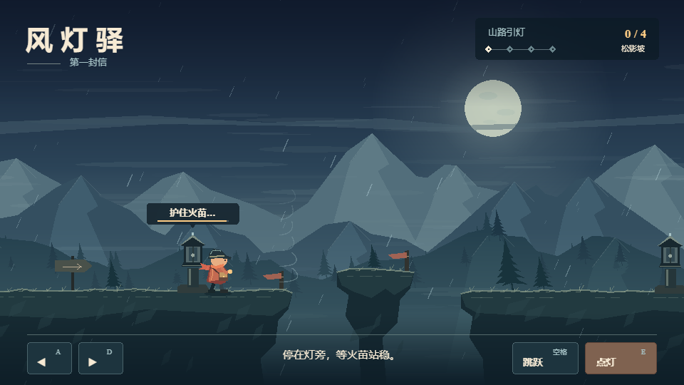

# 《风灯驿》：两个 Agent 入口生成的前 20 秒

[English](../../en/docs/first-playable-entry-study.md) | 简体中文 · [Agent 指南用法](agent-guide.md) · [录像、可运行首稿和实测记录](https://raw.githubusercontent.com/cnedwin/Egret_rebuild/main/guide/studies/windlamp-post/study.zip)

使用新入口生成的首稿可以操作邮差走到路灯旁，并尝试点灯，随后画面停住。旧入口首稿从打开起就一直黑屏。两份首稿都未点亮第一盏灯或完成送信，新入口首稿也超出了编辑预算。

## 录像里发生了什么

| 从打开页面算起 | A · 旧入口 | B · 新入口 |
| --- | --- | --- |
| 操作前 | 0.523 秒时，帧捕获报错 `FRAME_BUDGET_EXCEEDED`。五张定时采样图均为全黑。 | 第 3 秒可见邮差、熄灭的石灯、路牌和山崖，计数为 0/4。 |
| 第一次有效输入 | 没有可辨认的目标或操作提示。观察者在四个操作时段均选择等待。 | 4.003 秒起按住 D 键 1.5 秒。山路随人物移动，邮差来到灯旁；第 7 秒可见“按住 E / 点灯”。 |
| 尝试和结果 | 未观察到可玩的动作。 | 8.000 秒按下 E 键，出现火光、进度条和“护住火苗...”。8.624 秒报出同一错误。第 11、15、19 秒的画面完全相同，之后按 D 和空格均无可见回应，计数停在 0/4。 |

下图取自两段录像的第 19 秒。

| 旧入口 | 新入口 |
| --- | --- |
|  |  |

两份浏览器异常堆栈都指向共同引擎副本的同一个调用，检查单帧捕获几何的累计三角形数，上限为 65,536。最初的日志只能定位到预算检查。下文的诊断回放测出了各绘制对象的具体开销。[实验版本的帧捕获实现](https://github.com/cnedwin/Egret_rebuild/blob/5792d800a4932da81ddf6af9314a430c41cb0f30/packages/runtime/src/sharedFrameCapture.ts#L313)

## 两份首稿怎样生成

> 做一款名叫《风灯驿》的侧视小游戏。暴风熄灭了山路的引灯，玩家要让邮差带着第一封信抵达驿站。

这是为本次对照写的新需求，操作方式和过关解法留给作者设计。两组使用相同 HTML、起始游戏模块、960 × 540 逻辑画布和从 `5792d800` 构建的白鹭 2D 引擎。两组都只可在一次回答中替换 `game.mjs`，使用程序绘制原创画面。模型均为 `gpt-6.2-sol`、中等推理，无工具、无外部素材、无执行反馈。两份生成代码均原样保留。

A 收到旧版 `llms.txt`。B 收到新版 `llms.txt` 及其直达的两张卡的实际渲染文本。本次对照测量这一整套上下文，能否由 Agent 自主发现并打开链接仍待另测。

实验包保留了两组收到的完整提示。发布时，入口改用了仓库相对链接，给下载单文件版的读者补上了在线指南地址，并精简了两处标题，以符合 540 行上限。开场建议和两张卡的正文与 B 组收到的文字一致。

| 生成条件与结果 | A | B | 每组上限 |
| --- | ---: | ---: | ---: |
| 提示输入（UTF-8 字节） | 33,874 | 37,294 | 96,000 |
| 耗时（秒） | 241.249 | 247.713 | 480 |
| 游戏源码（UTF-8 字节） | 22,873 | 25,502 | 24,000 |

B 超出源码上限 1,502 字节。两份原始模型回答与对应游戏文件均完整保存。

## 怎样解读

在全新浏览器会话中，第 4、8、12、16 秒各允许一次根据可见画面作出的操作。观察者可事先只依照屏幕提示辨认控件；两份首稿用随机标签隐去组别，先写观察再揭晓。两段无声录像都从导航开始，使用 Windows、Chrome for Testing 157.0.8103.6、软件 WebGL2、960 × 540，解码均为每秒 20 帧、400 帧、20.000 秒。没有首次玩家参与。操作时点由协议规定，不能用作新手自行看懂玩法的时间。

下一份开场值得检查的是：邮差能否走近路灯，把灯真正点亮，并继续向前。这个对照说明“第一个动作可见”和“能打完第一段交互”值得分别记录。单次配对不能证明可重复的质量提升，也未产生预算内的获胜方案。

解压[实验包](https://raw.githubusercontent.com/cnedwin/Egret_rebuild/main/guide/studies/windlamp-post/study.zip)，在 `old-entry/` 与 `new-entry/` 目录分别播放 `first-20s.mp4`，或解压各自的 `draft.zip` 后用本地 HTTP 服务运行。包内保留原始提示和回答、预算、操作日志、盲评观察、源码与录像校验值，两份游戏都带有引擎许可文件。

## 后续复验：哪些图形用完了预算

每份原稿都做了两次诊断回放，游戏文件取自封存包。在引擎副本的原有几何检查处记录本次计数，第二次还记录了每个径向渐变生成的三角形数。两次都保留了原来的提交顺序和 65,536 个三角形的上限。下表统计的是帧捕获检查过的几何；GPU 实际绘制量和耗时另有测量口径。

| 首稿 | 主要开销 | 首个被拒绝的几何 |
| --- | --- | --- |
| A · 第一帧 | 天空占 24,626 个三角形，起点小屋占 16,964。位于世界坐标 x = 2,411 的终点驿站已挂入场景，远在 960 单位宽的初始镜头之外。驿站共占 27,716 个，其中三个径向光晕合计 27,556。 | 两次都是检查驿站时，累计值从 49,664 增至 77,380，捕获在此停止。 |
| B · 点亮第一盏灯时 | 远处驿站常驻 33,593 个三角形，其中三个径向渐变占 33,124。第一盏灯从 39 个增至 16,421 个，新出现的点亮光晕本身产生了 16,384 个。 | 一个已隐藏、形状未变的路标申请了 61 个。两次回放到此分别累计申请 65,586 和 65,590 个；它后面的特效尚未检查，未计入这些数值。 |

B 的游戏逻辑已经将第一盏灯设为点亮，但呈现这个结果的帧被拒绝了。原始录像里的计数因此停在 0/4。若只检查最后的 61 个三角形，就会错过真正新增的大光晕。从[实验版本的捕获代码](https://github.com/cnedwin/Egret_rebuild/blob/5792d800a4932da81ddf6af9314a430c41cb0f30/packages/runtime/src/sharedFrameCapture.ts#L1257)可以看到，挂在树上的几何会先接受预算检查，随后才决定是否绘制。

创作入口据此建议用少量平面色块表现装饰光晕，走近后再挂载远景，同时给动作成功、特效出现的那一帧留出余量。第三份首稿收到的是这条通用建议。前两份源码、个案计数和指定操作路线都没有交给生成模型。

### 第三份未经精修的首稿

沿用原中文需求、`gpt-6.2-sol` 模型（中等推理）、起始工程、引擎版本、一次回答、480 秒和 24,000 个 UTF-8 源码字节的上限。连同入口和两张卡在内，实际输入为 38,135 字节。模型用时 257.897 秒，输出 **24,387 字节，超出 387 字节**。录像使用了完整的原始回答。

| 从新会话打开游戏 | 走近第一盏灯 | 点亮 | 点亮后继续前进 |
| --- | --- | --- | --- |
| 原观察规则，四个操作时点 | 做到。4.85 秒时邮差在灯旁，出现了 E 键提示。持续向右 1.5 秒让他越过灯杆，从沟边跌落。 | 未做到。邮差回到起点，在那里按 E 已够不到灯，最终为 0/3。 | 未做到。 |
| 同一首稿，另开会话缩短移动时间 | 做到。向右走 0.81 秒后停在灯旁，第 7 秒仍可见「E / 点亮引灯」。 | 做到。第 8 秒按 E，第 11 秒可见灯发出暖光、沟上出现木桥，计数变为 1/3。 | 做到。第 12 秒向右走 0.32 秒，邮差越过灯杆来到桥头。到第 19 秒，灯、桥和 1/3 计数都还在。 |

两段录像都是从打开页面开始的连续 20.000 秒，每秒 20 帧，共 400 帧。测试环境为 Windows Chrome for Testing 157、软件 WebGL2，以及与旧稿相同的引擎。两段都没有报告页面异常。第二段证明停在操作范围内时，玩家可以完成这段玩法；第一段也保留了持续移动容易错过灯的事实。这次只有一份新生成的作品，使用自动化浏览器输入，没有首次玩家参与。

[下载两段录像、可运行的新稿、原始提示和回答、操作日志、三角形计数和复跑脚本](https://raw.githubusercontent.com/cnedwin/Egret_rebuild/main/guide/studies/windlamp-post/draw-budget.zip)
