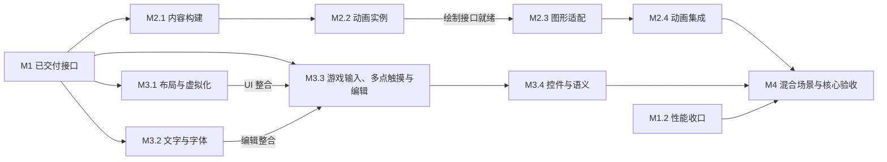

# M2–M4 架构与社区交付计划

[English](../../en/docs/m2-m4-delivery-plan.md) | 简体中文

2026-10-23 · 设计基线 3 · 工程预览 0.61.0

## 目标与当前基线

通过三项成果，让现有核心支撑动画丰富、界面复杂的游戏：完整且版本明确的 Spine 与内容支持，连贯的 UI／文字／输入系统，以及有明确证据的集成核心版本。本文是设计和实施路线，不代表这些能力已经实现，面向不了解此前讨论的贡献者。

[PR #81](https://github.com/cnedwin/Egret_rebuild/pull/81) 已在 main `f9801b7bbad807c424a1ce8866487034f08706c3` 交付捕获记录复用与准备缓存键有序扫描。四项必需 CI 通过，合并树与已审候选相同。M1.4 WebGL2 和 M1.5 资源清单／恢复已在其文档所述桌面范围集成。固定 M1.2 正式批次仍是有效失败：静态／稀疏／全脏 Engine p95 中位数为 5.0／6.4／10.3 ms，目标为 8 ms；全脏准备 ≤ 4 ms 的上界尚未建立，GPU 时间未测量。[#55](https://github.com/cnedwin/Egret_rebuild/issues/55) 继续开放。

子系统主计划为 [M2 Spine／内容](m2-spine-content-plan.md)、[M3 UI／文字／输入](m3-ui-text-input-plan.md)、[M4 核心验收](m4-core-acceptance-plan.md)。它们细化[整体架构计划](architecture-and-engineering-plan.md)，原始契约与失败测量继续保留。

M2.1 已有首批从源文件到构建产物的实现，覆盖 PNG、有限单页图集配置和序列帧，并接入持久缓存与项目采用。当前范围和证据参阅[内容构建契约](content-build-pipeline.md)。完整 Spine、字体和目标变体验收继续开放，保留既有十一个工作包。

## 架构选择

| 方案 | 后果 | 决策 |
| --- | --- | --- |
| 将每项实验各自扩成产品路径 | 重复纹理、调度和恢复所有权，混合场景难以统一推理 | 不采用 |
| 在共享显示／资源／渲染权威之上构建完整可选子系统 | 保留熟悉的 API 和已验证生命周期，同时允许内部优化 | 采用 |
| 重写核心，同时开发完整 3D、原生 SDK 和编辑器 | 推迟可用场景，丢失回归基础 | 这些产品线后续推进 |

渲染器继续采用能力明确的 WebGPU 与 WebGL2；Canvas 保留受限契约。Spine 不获取独立 GPU 上下文，UI 不另建资源管理器，构建服务不进入运行时依赖。新能力可以带来经评审的渲染内部改造，但不能暗中重新解释旧快照或提高既有准入上限。

## 系统边界与共享契约

| 边界 | 生产方 → 消费方 | 决策与交接证据 |
| --- | --- | --- |
| 源文件到构建 | 工程导入／构建 → 运行时资源获取 | 源身份、权利、导入／导出器版本、目标设置及传递依赖共同决定不可变产物身份。重建原子发布新代次。M2 负责产物格式与失效用例。 |
| 资源到实例 | 共享解码数据与租约 → 动画／UI 实例 | 数据可以共享；轨道、皮肤、事件游标、布局、选区及交互状态归各实例。Scope 负责取消与最终释放。M2／M3 共享既有所有权语义。 |
| 实例到渲染 | 动画采样和 UI 布局 → 经真实准入的有序帧数据 | 显式推进时间一次，捕获不推进时间。保留画家／插槽顺序，不可变历史帧不能引用复用的可变暂存。M2／M3 提供边界的公共行为示例。 |
| 渲染到设备 | 共享准备／驻留 → WebGPU／WebGL2 | 保留完整材质／裁剪键、有界上传和设备代次。资源释放与原生完成分别记录。新裁剪路径须提供两个声明后端的真实像素与丢失／恢复证据。 |
| 宿主到游戏／UI | 指针／键盘／组合输入／字体／语义 → 共享输入与 UI 控制器 | DOM／原生细节留在可选适配器，核心布局和事件不依赖宿主。晚到回调不得复活已释放 Scope。M3 负责输入／焦点／IME 契约。 |
| 内容到工具 | 稳定工程 ID、命令、诊断和产物 → 后续代码／可视化／Agent 工具 | 提供可序列化意图与准确诊断，不暴露原生对象。编辑通过既有事务权威执行；模型调用不进入逐帧执行。 |

保留现有四个核心包。可单独启用的 Spine 包按 M2 设计隔离经资格确认的第三方运行时、许可和包体边界，不成为默认引擎依赖。子计划中的建议类型和可选入口是设计目标，不是已有导出。每个工作包在依赖它的实现启动前，冻结跨模块签名、错误语义和兼容映射；在能力 Issue 与计划中评审，不另造全局契约登记体系。

### 帧序与替换语义

目标帧序为：输入／游戏修改 → 显式动画推进及事件队列 → 样式／测量／布局 → 变换／裁剪 → 有序捕获／准备 → 分阶段上传 → 提交。阶段内触发的用户回调在已说明的安全边界处理，限制工作量并诊断循环。已保存帧保持稳定。

替换期间保留旧代次可用，先构建、校验候选并获取新依赖，再在一个帧边界提交。失败或取消保留旧代次，旧请求不能覆盖更新意图。GPU 丢失时，从保留或重新获取的源重建设备派生数据，不重放已消费的游戏事件。M2 内容替换与 M3 字体／皮肤／布局失效共同验证这套语义。

### 责任与提交边界

保留现有十一个工作包及父 Issues。每个边界的责任角色在下游实现消费接口之前，将决定和验收用例写入既有工作包计划与 Issue；不新增全局冻结阶段、契约登记体系或审批层级。贡献者可负责包内边界明确的 PR，无需承担整个子系统。维护者确认贡献者及评审人，下表角色不代表向志愿者派单。

| 边界 | 责任工作包／协作责任方 | 必需交接 |
| --- | --- | --- |
| 动画推进、跳转与事件提交 | M2.2 动画维护者；M2.1 验证上游行为 | 普通更新失败状态、可重放历史和发布规则；不能假设可变上游状态可以低成本回滚。 |
| Spine 几何与颜色兼容 | M2.3 渲染维护者与 M2.2 | 有序独占几何及准确颜色／alpha 语义；优先扩展能力，仅在证实表示或语义不兼容时升级共享协议。 |
| 资源替换 | M2.4 资源／动画维护者 | 候选就绪、资源／设备代次及保留／重置策略；GPU 恢复不导致全局游戏时钟等待。 |
| UI 已提交版本 | M3.1 UI 维护者与 M3.2 文字、M3.3 输入 | 覆盖布局、绘制、命中几何、焦点及语义的最小一致更新域；过时工作不能发布。 |
| alpha 遮罩与离屏效果 | M3.4 渲染责任方与 UI 维护者 | 共享目标／pass 执行、生命周期及双后端参考；这是 M3.4 内明确的渲染交付。 |
| 混合场景与测量 | M4.1 集成责任方；M4.2 性能责任方 | 持续扩展的同一可执行参考、准确修改序列及完整引擎计时；M4.3 仅报告已验证范围。 |

M4.1 随真实接口可用，逐步把动画、虚拟化 UI、多语言文字／输入、替换及恢复纳入同一个示例。早期子集暴露集成和预算风险，不代表最终组合配置验收。M1.2 保留原始失败测量和最终性能门禁，不成为独立 M2／M3 工作或首次集成的前置。

创作内容需要稳定 ID、声明式意图，以及基于既有工程事务权威的显式编辑边界。运行时缓存、原生对象及临时播放状态不进入保存的工程数据。完整编辑器命令／撤销 schema 不是 M3 的进入条件。持久化 UI 声明不引入任意可执行回调。

## 交付顺序与并行关系

1. 发布契约、用例和任务所有权边界。M2 内容／动画规划、M3 布局／文字、M4 场景材料编写可以先行，不必等待所有 M1 计时工作。保留 M1 计时候选与失败结果。
2. M2 与 M3 按子计划依赖实施。接口就绪允许围绕它开展工作，不代表实现验收；依赖尚不可用生产方 API 的消费者不能先合并。
3. 连贯子集可运行后即开始场景集成。M4 最终验收等待 M2／M3 必需功能、M1.2 性能收口及声明设备／材料证据。未通过的必需项不能通过换里程碑变成通过。
4. 只有桌面证据时可发布范围明确的工程预览；稳定核心或设备支持声明必须具有对应完整验收。M4 不认证整个产品路线。

顺序由依赖决定，不承诺人员数量或日历工期。每项公共接口只有一个维护责任方，修改共享准备／资源模块前协调并行贡献。

### 移动输入责任与交付

移动触摸及独立多接触点属于 M3 必需功能和 M4 必需验收。保留十一个工作包：M3.3（#89）负责无宿主的游戏／UI 触点状态、逐触点路由／捕获／取消及浏览器适配；M3.4（#90）负责手势仲裁、无障碍控件和双手操作示例；M4.1（#91）将移动变体整合进同一可编辑工程；M4.2（#92）按 X-MTouch/1 负责 Android Chrome／iPhone Safari 真机验收；M4.3（#93）只发布已证明组合。M3.1 提供已提交命中几何，M3.2 提供文字就绪状态，M2 接收游戏命令而不另装输入监听器。

M3.3 可基于既有显示／Scope 契约先交付基础游戏多触点能力，不等待自动 UI 布局或 IME 完成；随后 UI 整合消费 M3.1／M3.2，同包仍须完成既有焦点／编辑要求。输入是场景与 UI 共用的可选核心能力，不依赖完整 UI／文字系统。保持旧鼠标 API 兼容，桌面回归单独保留。详细触点契约、手势归属见 M3，设备／动作／预算矩阵见 M4，不新增登记表、任务族或验收框架。

两个必需手机行初始状态均为 OPEN。真实触摸、取消、同时操作控件、滚动、旋转及键盘行为须真机验证；CI 和桌面模拟不能关闭。X-D60/1 及 M1.2 原失败计时不变。有限桌面预览可先于手机资格交付，但不能关闭 M3／M4 或宣称移动支持。小游戏／原生宿主仍单独规划，共享输入契约保留扩展边界而不认证这些宿主。

## 现有代码：保留、重构与退役

| 动作 | 位置与原因 |
| --- | --- |
| 保留语义 | `packages/runtime` 的 Scope、事件、显示树、资源租约、时间与序列帧原语；`packages/project` 事务及严格规划器。保留既有公共行为和失败用例。 |
| 经共享权威扩展 | `packages/engine` 共享 WebGPU／WebGL2 宿主、清单资源、页驻留及分阶段恢复，Spine／UI 均进入这些路径。 |
| 有选择地重构 | 捕获／准备仅因已测成本或必需新材质／裁剪契约调整；文字缓存补全段落／字体键；纯布局工具接入 UI 协调但保留独立入口。 |
| 产品适配器替代实验 | 有界 Spine 实验保留为参考用例，不直接作为完整产品运行时。保留原许可及原始证据，不能仅删除实验限制。 |
| 保留有界 3D | 既有场景合成用于 M4 背景及深度／顺序回归；新模型导入、完整材质、角色、世界编辑与通用特效属于后续工作。 |
| 有迁移证据再退役 | 预览 API 替换须有旧→新映射、语义差异、可运行迁移用例和明确删除时点；不能为简化验收暗中破坏既有示例。 |

## 验收与尚未确定的事实

每个工作包拥有一份能力契约、一个可执行场景和一张验收表。每行记录输入／版本、预期结果、方法、实际环境、观察结果及限制。已实现、在此环境已验证、正式支持是不同状态。

沿用 U／A／X／L：U 为 10,000 逻辑／1,000 可见节点、八层裁剪及 50,000 条变高记录；A 为 20 个独立 Spine 实例与 200 个序列帧实例；X 选取明确冻结的组合，不累加所有最大值；L 为 100 次进入／退出／替换／取消循环，适用后端十次真实丢失／恢复及 30 分钟持续运行。这些是目标场景，不是已经演示的新能力。

保留 D60 引擎 CPU p95 ≤ 8 ms、准备 ≤ 4 ms、帧间隔 p95 ≤ 16.7 ms 与 p99 ≤ 33.4 ms。GPU 可测时单独测量。保留 30 秒预热后五次 60 秒运行、准确内容／环境及所有原始样本。M4 在测量前确定组合场景内存、可选 Spine 传输及文字预算，不能拿较小 M1 场景的内存数字作为更大负载的证明。具体正确性及取消用例见各子计划。

| 开放边界 | 责任角色 | 解除条件及影响 |
| --- | --- | --- |
| M1.2 全脏 CPU／准备 | 渲染维护者 | 实测实现改善并通过固定正式验收；阻塞 M1／M4 核心性能，不阻塞独立 UI 设计 |
| Spine 版本、授权及分发 | 动画维护者与发布维护者 | 准确导出／运行时身份、授权素材及适用声明；阻塞无条件完整 Spine／支持声明 |
| 字体、IME、无障碍及目标设备 | UI／宿主维护者与志愿测试者 | 合法字体集及真实键盘／IME／读屏／设备执行；合成事件不能关闭这些行 |
| 独立新人／fork | 社区维护者与新贡献者 | 未参与建设者实际完成公开贡献流程之前，#52 保持开放 |
| Projects 看板协作 | 仓库／社区维护者 | 2026-10-21 已恢复访问；复用既有看板与十一个 Issues，保留历史，区分接口就绪与实现验收。 |

## 社区任务结构

保留现有父 Issue [M2 #56](https://github.com/cnedwin/Egret_rebuild/issues/56)、[M3 #57](https://github.com/cnedwin/Egret_rebuild/issues/57)、[M4 #58](https://github.com/cnedwin/Egret_rebuild/issues/58)，保留既有十一个子 Issues，分别对应子计划中的完整工作包。父 Issue 保留此前讨论、依赖和验收链接，不与实现任务重复竞争。M0 #52／#54 和 M1 #55 保留真实缺口。

每个子 Issue 英文在前、中文在后，说明结果、范围与非目标、实际代码入口、依赖、目标接口、验收、当前限制及评审角色。贡献者通过评论认领并说明范围与方案，维护者确认归属和冲突，不擅自给具体人员派单。`help wanted` 表示欢迎参与，不代表架构任务适合直接标成新人任务。新人可以先在同一工作包内贡献授权用例、复现或文档。

只增加少量能力领域及 ready／blocked 标签。Ready 表示其首项声明交付没有未满足的前置；blocked 写清前置或外部条件。用含具体证据的草稿 PR 开始评审。Done 要求代码集成及工作包声明的验收完成，不以关闭 PR 代替。Issue 正文中的依赖无需 Projects 账户也可阅读。

GitHub 改造顺序：保留当前 Issues／里程碑 → 发布经审计划与入口 → 更新三个父 Issue → 维护既有十一个子包及里程碑关联 → 按真实依赖标注 ready／blocked → 回读检查一致性。不为让路线看起来简单而关闭历史任务或改写贡献者讨论。Projects 权限已恢复，继续将同一批 Issues 和状态映射到现有看板，不另建项目。

从 `pnpm setup:dev`、`pnpm check:quick`、`pnpm example:browser` 开始。开发中使用 `node tools/check-incremental.mjs --base origin/main`，当前元数据集成由维护者负责。最终发布保留双语／来源检查、独立评审、相关真实浏览器证据及必需完整合并 CI。长时与性能证据服务于对应验收声明；纯文档修改不重跑图形基准。M2–M4 不包含新的维护自动化项目。

## M4 之后的产品连续性

All-in-one 创作平台仍是后续产品线：Coding／调试、主画布、UI／动画编辑与发布，加上 3D 场景／特效、世界和角色编辑。Agent harness 与手动高级编辑共享工程命令，支持指定模型 API、Skills／MCP、插件，以及 Token 统计和可配置消费额度。M2–M4 为其提供稳定内容身份、诊断、事务和可回放示例，不实现整个平台，也不让模型推理成为运行时状态权威。完整一键旧工程迁移及原生／小游戏／桌面宿主仍是明确的后续交付。

## 证据与来源原则

当前事实来自 [M1 计划](m1-rendering-resource-plan.md)、[渲染证据](incremental-frame-preparation-evidence.md)、[资源恢复证据](resource-recovery-evidence.md)、[产品组成](产品组成.md)及各子计划列出的实际源码入口。外部机制／格式参考放在相关决策旁，鸣谢技术来源；除明确合规的依赖外坚持独立实现。本设计由 AI 协助整理，遵循与其他架构贡献相同的评审要求。

[可选 Spine 内容接入](spine-content-ingress.md)在 M2.1 内增加固定 Core4.3.13 的资产 SDK：原始 JSON／图集绑定、共享设置与页面租约、显式生命周期。附带条件的运行库许可及原创程序化夹具与稳定导出／独立参考验收分别记录。本次不交付 Spine Node producer、播放器或图形；M2.1–M2.4 及既有 Issues 按各自剩余验收继续开放。
