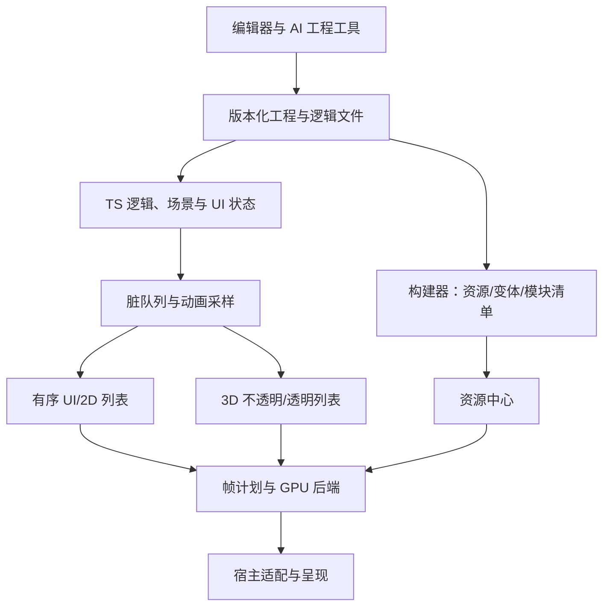

# 技术架构

[English](../../en/docs/technical-architecture.md) | 简体中文

白鹭的架构将可编辑游戏工程连接到行为可预测的Runtime。工程文件保存意图与稳定身份，运行实例拥有游戏状态，渲染后端消费可重建执行数据，宿主适配器提供平台服务。复杂二维界面、动画和轻量三维由此共享资源，同时保留各自需要的执行策略。

[当前核心预览](core-progress.md)实现了这一方向的有限部分，完整UI、三维、Spine、生产宿主、AI工作台和迁移分别验收。

[知识库首页](../README.md) · [技术白皮书](技术白皮书.md) · [产品需求](产品需求说明书.md) · [工程规划](工程规划.md) · [需求登记](../registry/需求.json) · [决策登记](../registry/决策.json)

## 设计起点

R002定义复杂UI二维与轻量三维创作，R003将渲染和Runtime作为基础，R004覆盖场景、角色、VFX、UI、二维骨骼和序列帧。内容规模、目标设备和首发宿主仍待固定；R005中的加载、帧时、内存和功耗目标须以等价任务测量。

设计统一工程与资源合同，按负载组织执行。熟悉的TypeScript场景与显示API表达游戏语义，紧凑执行数据服务渲染及经测量确认的热点。UI顺序和布局保持明确语义，不强塞入三维对象模型。[产品组成](产品组成.md)定义周边工具和服务边界。

## 数据权威与接口合同

| 层 | 权威与约束 |
|---|---|
| 创作工程 | 工程、场景、组件、材质、动画 schema 与逻辑文件是持久化权威；保存带版本，稳定对象 ID 支持差异、迁移与来源追踪。 |
| 运行状态 | TS 逻辑层拥有游戏状态、场景变更、动画时钟与事件；加载工程形成初始状态，运行中的临时状态不反向静默修改工程。 |
| 执行镜像 | C++/WASM/GPU 仅持有可重建投影；布局、命中、边界查询优先在所属层计算或异步回传，避免双向逐属性同步。 |
| 构建产物 | 内容哈希、工具版本、目标能力 profile 与依赖清单决定派生资源；缓存不是权威，丢失后可重建。 |
| 宿主 | 适配器提供 surface、输入/IME、时钟与呈现、音频、文件/网络/存储、生命周期和权限；能力探测与错误分类不得伪装成全部浏览器 API。 |

桥接包需含协议版本、对象 ID/代际、帧序号、资源就绪依赖及缓冲所有权。创建、更新、销毁在确定帧边界应用；销毁后的旧异步回调按代际丢弃。队列设容量与背压，禁止无限积压；允许合并可覆盖的状态更新，必须保留事件顺序。协议不兼容、序号缺口或上下文丢失时停止提交，按已确认快照重建镜像并重新绑定资源，不能以忽略命令恢复。

资源中心分别跟踪下载/解码产物、CPU 数据和 GPU 句柄，使用显式场景租约与依赖所有权。卸载先取消任务、解除引用，再在 GPU 使用完成后释放；异步换图保持旧资源至新资源就绪。加载失败有超时、有限重试、占位或明确阻断；OOM 先释放可重建缓存和降低可选质量，仍无法满足预算则返回可诊断错误。后台恢复重置时钟基线，避免补跑无限帧；设备丢失可重建图形状态，不应重发已消费的游戏事件。

## AI 工具与旧工程约束

R006 的 AI 工程工具通过有版本的工程命令、schema 和开发诊断工作，不进入每帧渲染循环。修改先校验依赖和能力要求，记录来源与差异，生成可预览结果；事务失败恢复原工程。自然语言建议不能越过工程验证直接变成运行时权威。

R008 已是首个完整发布目标的正式交付要求：[旧工程一键 AI 迁移](旧工程迁移.md)必须从核心接口设计纳入。V006 最终依赖 V001—V005。显示顺序、坐标/锚点、事件、计时、遮罩/滤镜、EUI 和动画语义需要映射；兼容模块按依赖裁剪。旧工程固定为视觉、行为、资源和平台回归样本，报告自动转换覆盖率与人工介入，不能以“导入成功”代替“移植后运行正确”。

## 选型边界

TypeScript公共接口是开发者主要边界。可选Rust/C++、WASM及原生执行按具体端到端瓶颈评价，计入初始化、数据传递、归属、调试和恢复。图形设计采用现代资源、pipeline和pass合同，兼容执行器保留声明语义；Canvas保持独立有限profile及文字/离屏provider职责。实际包与子路径遵循[工程结构](工程技术架构与项目结构.md)、[API规范](公共API设计与命名规范.md)及[质量门禁](代码规范与质量门禁.md)。

平台提案需要真实SDK、设备和版本证据；API存在不等于支持已成立。首批宿主、团队、工期及数字性能预算尚未确认。[渲染与Runtime](渲染引擎与运行时.md)、[优势与验证](核心优势与验证.md)及[交付计划](交付计划.md)规定对应验收工作。

## 已执行成熟实现基线

R012通过可替换参考链评价机制，如实记录Three r186渲染、glTF导入、动画以及Canvas文字和资源/状态适配。17/17检查覆盖有限资产共享、独立pose、文字/图形交接、恢复及错误，见[采用记录](开源参考实现与采用方案.md)、[第三轮集成](../archive/第三轮研究.md#execution)和[审计](../archive/第三轮研究.md#audit)。它保持第三方身份和研究范围；完整复杂UI、二维骨骼、角色、CJK/IME、宿主及比较收益仍开放。

## 后端与原生集成

[后端与原生选型研究](图形后端编译与原生Runtime选型.md)评价WebGPU/WebGL/Canvas职责、TS7、Rust/C++、VM、原生图形库及可能的桌面/GPU-AI扩展。其10月8日研究截止没有安装或执行这些候选，也没有扩充独立参考链的17项覆盖；该截止D013–D015仍为proposed、H008为untested。后续有限浏览器包不代表选定原生库或VM。

## 核心实现来源

R015及[独立实现规范](独立实现与第三方依赖规范.md)要求白鹭核心依据自有规格编写。标准与源码研究解释机制，外部库保留名称、版本、许可和声明。早期第三方参考链与独立核心分别记录；AI辅助编写遵循同样的来源、审查和可执行验证要求。

## 工程结构与公共代码合同

R016在熟悉白鹭领域命名的同时建立显式实例、模块边界和生命周期合同。D016更广包计划在已实现包之外仍为候选。[首段核心记录](核心框架实现记录.md)保留当时无头范围，后续交付记录说明后续API；完整图形/宿主覆盖、CI及R008/V006迁移分别设门槛。

## 研究基础与证据缺口

R011将决策连接到持续研究与验证。2026年10月8日、知识库0.7.0架构截止记录D001–D016为proposed、H001–H008为untested，V001研究in_progress、V002已有本地无头核心，V003–V006产品实现not_started。这些保留为有日期的历史，不能用来描述全部后续小包的当前状态。

[第二轮执行](../archive/第二轮研究.md#execution)及[审计](../archive/第二轮研究.md#audit)部分验证独立事件流、逐租约资源、嵌套布局/命中、批次状态和程序WebGL场景。[第一轮执行](../archive/第一轮研究.md#execution)与[研究核查](../archive/第一轮研究.md#research)另存。它们未覆盖完整资产、字体/骨骼语义、真实JS/WASM/C++桥接或设备预算。

历史Runtime静态审阅观察到二进制命令桥接、保留树、相邻纹理合批和脏缓存，未证明当前可构建或平台性能；同时发现旧网络代码关闭证书校验，复用前须复核并修正安全默认值。

有版本的比较资料包括[Cocos JSB传递成本](https://docs.cocos.com/creator/3.8/manual/en/advanced-topics/jsb-optimizations.html)、[Cocos 3.8管线迁移](https://docs.cocos.com/creator/3.8/manual/zh/render-pipeline/overview.html)、[LayaAir 3.3.0发布](https://github.com/layabox/LayaAir/releases/tag/v3.3.0)和[Godot 3→4迁移](https://docs.godotengine.org/en/4.7/tutorials/migrating/upgrading_to_godot_4.html)。研究保留Laya 3.3/3.4来源日期冲突，IDE与旧官网日期未重验。这些资料说明特定机制及升级约束，不建立当前速度排名。

原V008产物为0.6候选白皮书、PRD与工程规划包，属于文档交付，不是完整产品实现。
