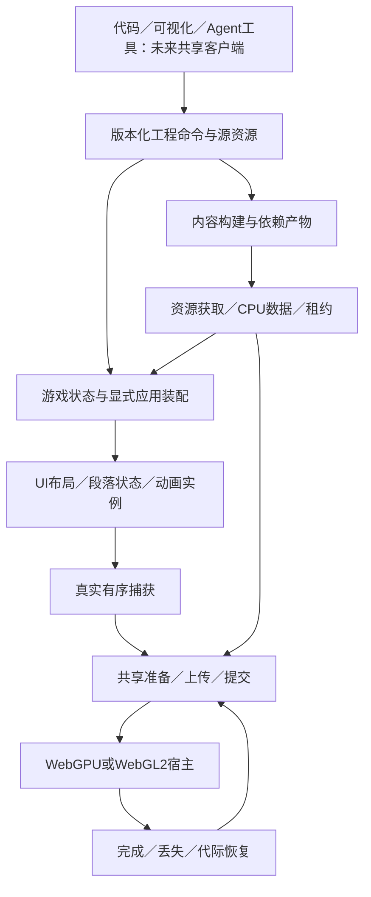

# 技术白皮书

[English](../../en/docs/technical-white-paper.md) | 简体中文

架构复盘：2026-11-07。实现观察以 main [f869b37](https://github.com/cnedwin/Egret_rebuild/commit/f869b3733366d1fea0c71adba2cdc3ea03fe7ba1) 为准。[当前能力](core-progress.md)、[产品需求](产品需求说明书.md)和[工程计划](工程规划.md)分别说明可运行行为、必需验收和后续工作。

## 产品与架构方向

白鹭服务于借助 AI 制作游戏的新创作者，以及需要可理解代码、可预测运行行为和集成工具的开发者。差异化目标是以精简的 Web 核心组合复杂 2D UI、动画与轻量 3D，再让自然语言、可视化和代码共同编辑同一个工程。低加载成本、持续响应和受控资源使用是设计目标，需要等价负载的实际测量证明。

已选基础是 TypeScript 游戏语义、共享渲染与资源权威，以及按需启用的专业 provider。WebGPU 是现代执行路径，WebGL2 是持续维护的兼容路径，Canvas 使用较小的显式档位。WASM／原生代码进入有测量依据的专业或宿主边界；重写语言或 API 名称本身不产生性能优势。

已实现四个基础包：contracts、runtime、engine、project。第五个可选 Spine 包隔离显式上游运行库及其许可。图形和浏览器宿主代码目前位于 engine 内。独立 graphics／hosts／toolchain／CLI 包、Rust crate 和编辑器应用是后续可能的组织方式，不是前置条件或现有公共 API。

## 一个工程，明确的状态权威

图示表达责任边界。工程事务和运行时 API 已存在，完整工程到游戏编译器及集成工具客户端尚未交付。

持久化工程 ID、可编辑资源和修订属于工程服务；游戏值、显示层级、动画状态与已消费事件属于应用／运行时；CPU 缓存和 GPU 对象属于派生状态。原生指针、缓存项和显示对象地址不能成为持久化工程身份。

显示父子关系与销毁、资源所有权不同。Scope 取消需求并负责清理，租约独立保持共享数据存活；只有 Host 能确认原生完成与退役。对象离开显示树，不代表其数据或 GPU 分配已退役。

## 共享帧执行

整合顺序是：输入／玩法操作 → 显式推进游戏时间与动画 → 样式／测量／布局 → 变换／裁剪 → 有序捕获／准备 → 有界资源上传 → 提交。现有公共 API 显式完成这些操作，这个顺序不表示已经存在自动 Engine 更新或编辑器调度器。

捕获帧不推进动画。用户修改和回调必须进入已定义的安全边界，取消、重入和循环错误保持可观察。保存的帧在临时存储、源实例或设备代次改变后仍保留独占不可变数据。

透明 UI、Spine 插槽和特效保持创作顺序，仅合并相邻兼容命令；完整键包括目标、材质、纹理／采样、混合／颜色和裁剪。不透明 3D 可在声明契约内单独按深度／材质排序。全局按纹理重排会改变游戏画面。

增量捕获／准备及等待完成后的安全缓冲／纹理复用已实现。新优化须说明在实际负载中消除了哪些工作，并保留完整路径比较。静态复用计数是正确性证据，不能代替完整引擎计时。

## 渲染、颜色与特效

共享 WebGPU／WebGL2 路径采用共同的准入几何与资源语义，各后端负责真实对象、命令和代次。发布前检查必需能力；回退时不能静默丢失特效。

纹理页保持裁剪、裁边、旋转、逻辑尺寸与采样身份。色彩空间、直通／预乘 Alpha 及混合公式采用显式档位。Spine 的 egret-shared-linear/1 接入不代表与旧 gamma 空间等价或覆盖所有上游渲染档位。

共享 Alpha 遮罩与有界可分离离屏模糊已使用同一渲染／资源生命周期。目标和临时工作按像素范围与重叠代次限制，而不是只按对象数。UI 提供特效参数和失效，渲染器负责目标复用、pass 顺序、完成与恢复。当前核心不以通用着色器图为前提。

Canvas 保留基础 2D／文字路径，能绘制图像不等于具备完整 Spine、3D 或滤镜等价。WebGL1、原生图形库及跨 API 共享需要单独选择宿主并验收。

## 资源、内容与替换

内容链路是：源资源 → 版本化导入／构建 → 不可变产物／依赖 → 清单准入 → 共享 provider／租约 → 实例 → 捕获渲染。稳定源身份不同于构建身份、运行时资源代次和设备代次。

选定 PNG、图集、多页、序列和字体构建及运行时组已实现，Spine JSON 使用可选整合。Spine 二进制产物、压缩／mip 目标变体和完整导出器兼容继续由 M2.1 完成。构建工具不进入默认游戏循环。

网络、解码、语义构造、CPU 发布与设备上传分别记录就绪和容量。取消消费者只释放其需求；真实未结束工作在完成前继续记账。迟到结果不能恢复已销毁 Scope，也不能覆盖更新意图。

已有 Bitmap、序列及 Spine 替换契约在准备候选时保持原活动代次。RESET 是显式重置，不等于兼容保留任意播放状态。保留状态的后续能力须在提交前定义身份／名称兼容、时间／轨道／皮肤／事件和拒绝规则。GPU 丢失只重建设备派生状态，不重放已消费玩法事件。

## 复杂 UI、文字与输入

托管 UI 负责测量、排列、绘制和交互几何的一致修订。最小更新域在必要时覆盖依赖祖先、兄弟、弹窗锚点和焦点／编辑状态。待定或失败的异步工作保留上一提交，其他域仍可使用。

变高虚拟化采用稳定业务键、高度索引、有界可见／overscan 行及滚动锚点。焦点／组合输入行需要单独有界保留策略。行复用前终止旧绑定，旧文字／皮肤异步结果不能填入另一记录。

只读段落已使用宿主注入的 CanvasKit／SkParagraph provider、显式字体字节、多样式和最终行双向排版。已提交命中、选区和插入点几何来自同一原生布局与栅格结果。字体代次及 provider 身份参与缓存键；T1／TF1／WC1 兼容入口保持原范围。

早期 ICU／HarfBuzz／FreeType 方案通过选定 provider 整合实现，不是再建一套段落引擎的指令。私有 Unicode／双向比较保留准确来源及一致性范围。必需文字／字体／墨迹独立参考、provider 传输／启动成本及完整内存资格仍开放。

M3.3 负责下一项原生纯文本编辑器。活动编辑时，真实可聚焦 input／textarea 负责浏览器组合、选区和编辑几何；Engine 负责已提交值／修订，经完整交接再进入段落／UI 发布。原生与栅格文字需声明重排／锚点容差，不虚构像素一致保证。目前尚未交付活动编辑器。

鼠标兼容、多触点路由、键盘／焦点及社区移动／动作状态已存在。手势／控件接线、弹出／模态仲裁、语义投影和真实 IME／无障碍验收分别推进。拾取消费已提交几何，不猜测字符宽度或读取 GPU 像素。现有触摸贡献者保留该实现范围。

## Spine 与 3D

可选 Spine 包以官方 Core 4.3.13 负责语义计算，第一方白鹭代码负责资产、实例、调度、几何、RESET 和恢复整合。准确版本不代表最新发布；运行库再分发条件及素材权利与白鹭 Apache-2.0 许可分别处理。

独立播放、组合皮肤、有限播放和有序共享图形已实现。完整选定版本支持仍需适用附件／约束／物理／时间线／混合／参考矩阵、二进制准入、跳转／重放和兼容替换。程序化夹具及共用同一 Core 的两个适配器不能独立认证全部创作动画语义。

当前 3D 为有界自有几何、矩阵、不透明场景渲染及 2D 叠层。模型导入、完整材质、3D 角色动画和通用特效属于后续产品工作。它们复用资源／构建／Host 所有权和可选入口，从可编辑资产到场景的完整切片开始，不另建渲染器。

## 宿主、恢复与原生 Runtime

浏览器宿主负责表面、呈现及可选输入／字体／网络适配。共享恢复区分资源就绪、新设备代次显示就绪和交互就绪；可见恢复帧不能单独证明玩法或输入已恢复。

桌面和有界 Android 结果分别记录在[证据](android-device-validation.md)中，不据此认证自发驱动故障、操作系统杀进程、所有手机、小游戏 SDK 或原生 App。微信、抖音、Instant Games、Discord 和 Telegram 各自需要真实容器／服务／生命周期及分发检查。

未来原生 App／嵌入式 SDK 需共同解决图形、一个选定 JS 虚拟机、字体、输入、音频／存储／生命周期和调试。Rust／C++、wgpu／Dawn 仍是按模块／provider 评估的选项，不把整体替换 TypeScript 核心当作自动性能修复。Steam／桌面图形及 GPU 辅助 AI 属扩展方向，另需设备、延迟和质量证据。

## 创作平台与迁移

一体化平台保留 Coding／调试、主画布、UI／动画编辑和发布，并增加 3D 场景／特效、世界及角色编辑。改善工作流时可组合编辑界面；自然语言与手动高级编辑共用版本化工程及可见差异／撤销语义。

外部 Agent harness 将支持用户指定模型 API、Skill、MCP 工具和插件，直观显示 Token 消耗并提供可设置额度。模型凭据、调用和计费不进入帧执行。已有工程事务只是基础，不是已完成 Agent 服务或编辑器。

旧工程迁移始终是完整产品义务：保留可运行旧基线、盘点依赖、先确定性转换再有界 Agent 修复，比较行为／画面／事件／资源／平台，并继续编辑、发布与更新新工程。当前 RES／MovieClip 规划器是前置能力，不是一键整工程迁移。

## 测量与交付

M1.2 原全脏 Engine p95 中位数为 10.3 ms，目标 8 ms；准备覆盖与 GPU 时间分别保留边界。M4 完整引擎区间包含输入、动画／事件、布局、捕获、准备和同步提交，不能相加阶段 p95 得出完整引擎 p95。

测量真实冷传输、必需 provider／字体初始化、首次交互、持续长尾、替换峰值及清理。早期约 25.85 MB 的段落原始负载不是压缩传输或完整 X 预算。M4 正式采集前须绑定已采用 provider 与真实资源，不静默放宽原目标。

逻辑租约、JS 堆、WASM 容量、后备存储、GPU 计数和物理 RAM／VRAM 分属不同记账域。Android 补充验证说明了为什么缓存的 performance.memory 不能当作实时纯 JS 堆曲线。受控丢失、诊断 GC 和短时回调采样保持各自限制。

按完整行为包推进：集中实现、统一做受影响验证、独立源码／结果／双语评审、正常 hooks 及完整受保护合并检查。复用证据前比较其实际输入；里程碑／设备／性能声明仍需各自必需结果。

## 来源与连续性

当前契约和来源记录区分独立编写的白鹭代码、采用依赖及其声明。[第一轮](../archive/第一轮研究.md)、[第二轮](../archive/第二轮研究.md)和[第三轮](../archive/第三轮研究.md)研究保留原机制、失败与审计，不是当前产品验收。[旧白皮书](https://github.com/cnedwin/Egret_rebuild/blob/f869b3733366d1fea0c71adba2cdc3ea03fe7ba1/knowledge-base/Cns/docs/技术白皮书.md)保留早期方案和有日期的观察。

参见[架构计划](architecture-and-engineering-plan.md)、[M2–M4 路线图](m2-m4-delivery-plan.md)、[实现／依赖政策](独立实现与第三方依赖规范.md)及[来源账本](https://github.com/cnedwin/Egret_rebuild/blob/main/source-origin.json)。本次复盘不修改原始证据、上游许可、包依赖或引擎行为。
