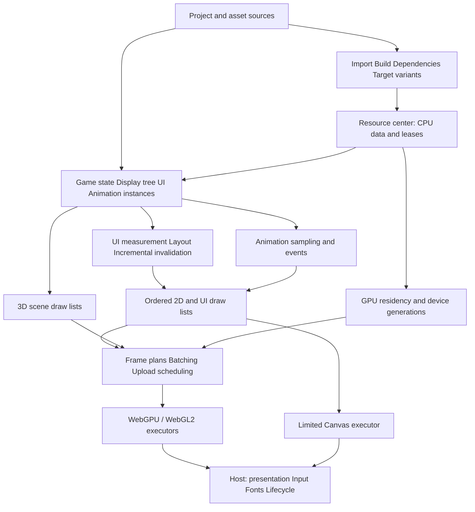
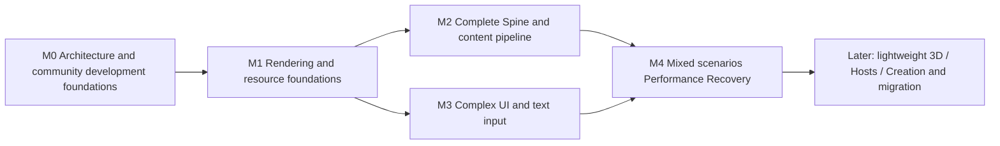

# Egret Engine architecture and engineering plan

English | [中文](../../Cns/docs/architecture-and-engineering-plan.md)

2026-10-17 · Plan version 5 · M0–M4

The implementation baseline is Main `030a34646774dea6c46cc947b55186da9265a6c8` (engineering preview 0.61.0). This plan defines target architecture, code disposition, dependencies and acceptance; it does not claim those capabilities are implemented. The first M0 infrastructure delivery merged as Main `26136df66a493eb721e0780148de4bdc8ed4fb87` through PR #51. The public board and technical newcomer rehearsal extend that baseline; new engine features remain paused. The [M0 delivery record](m0-community-foundations.md) distinguishes verified infrastructure, human/device constraints and outstanding engineering acceptance.

The selected environment pins Node 26.7.0, pnpm 11.25.0, TypeScript 7.0.2 and PowerShell 7.6.5. Historical evidence retains its original environment. Current check and browser-tool migration status is in the M0 record.

M0 contribution tooling now separates content/declarations from maintainer-generated current ledgers. CI checks integration against its explicit PR base without branch write permissions. Four current browser suites have a Node 26.7.0 entry; fixed Node 24 experiments remain historical and advanced source/snapshot tools retain separate migration obligations. This does not activate incremental merge-test selection: full checks remain in force. No engine feature work resumes before the remaining M0 decisions and acceptance.

## 1. Objectives, scope and tradeoffs

Deliver an independently implemented engine core for complex interfaces, complete versioned Spine animation, frame animation and subsequent lightweight 3D. The primary audience remains new creators making games with AI assistance. Developer interfaces retain familiar Egret display, event, resource and time concepts.

The current program prioritizes rendering performance, complex UI, complete Spine and the resource pipeline. Complete usage scenarios replace narrow experiments as acceptance units. Performance must coexist with visual, interaction, event and lifetime correctness; removing effects or ignoring failures cannot establish an improvement.

Community collaboration is an engineering foundation for these objectives. Developers must be able to build, verify and contribute without depending on a maintainer's local machine state. Shared metadata maintenance must not grow with every parallel feature. Explicit responsibilities and automation reduce participation costs while preserving quality standards.

Choose gradual restructuring that preserves public semantics while replacing internal execution paths:

| Approach | Outcome and cost | Decision |
| --- | --- | --- |
| Continue adding features to every existing execution path | Small local changes initially, but repeated preparation, multiple routes and redundant resource work accumulate | Not the main approach |
| Preserve semantics and verified lifetimes; rebuild execution and scheduling | Reuses working assets and permits reference comparisons; requires explicit migration and budget boundaries | Recommended |
| Rewrite the entire core while expanding native, desktop and editor work | Expands delivery risk, loses verified behavior and delays a usable core | Not selected |

This program does not implement the complete editor, Agent workbench, native SDK, Steam support, full 3D or complete legacy migration. These remain overall product objectives. Project identities, manifests, diagnostics and compatibility fixtures must accommodate them early. Existing requirements, including complete migration R008/V006 and Spine R020/V020, are not removed by narrowing this stage.

## 2. Baseline and engineering assessment

The baseline includes the display tree, coordinates and bounds, basic Canvas/WebGPU, textured meshes, nine-slice, shared resource acquisition and leases, Scope, explicit time, frame animation, basic text, mouse input and resource replacement. Finite desktop browser workflows have run. Spine remains a bounded experiment; 3D remains bounded geometry and scene composition. `@egret/runtime` is the TypeScript core, not a new native Runtime SDK.

Source inspection shows tree traversal and object construction during frame capture, two traversals in the textured route, per-draw buffer allocation/upload in WebGPU submission, and image residency keyed by image and crop. The 0.61.0 cache is not a complete performance system; its new dedicated cache browser matrix remains unfinished. These observations motivate optimization candidates, not measured performance conclusions.

Existing lifetime behavior, drawing order and original evidence remain regression foundations. New scale, platform, recovery and performance acceptance must be established separately. Historical passes do not certify the proposed architecture.

## 3. Architecture and responsibilities

### 3.1 Authority and boundaries

- Project files own editable content, stable IDs, references and versions; build artifacts are rebuildable.
- TypeScript game and instance state own gameplay, display hierarchy, animation state and events. GPU data is derived.
- UI layout owns measurement and placement. Normal layout and picking do not require GPU readback.
- The resource center owns shared data and demand; GPU residency owns device resources and completion waits. Releasing a CPU lease does not prove GPU completion.
- Hosts supply input, IME, fonts, network/files, presentation and foreground/background lifecycle. Browser verification does not certify mini-game or native SDK hosts.
- AI operates through project commands, diagnostics and reversible transactions, outside the authoritative frame loop.

### 3.2 Module organization

Initially retain the four existing packages and reorganize internal responsibilities without creating many public packages:

| Location | Intended responsibility |
| --- | --- |
| `packages/contracts` | Small shared data contracts, capabilities, errors and versions; no other product-package dependencies |
| `packages/runtime` | Display state, events, Scope, resource leases and basic animation data; depends only on contracts |
| `packages/engine` | Clock, UI/animation coordination, incremental preparation and frame plans; optional browser executor entries |
| `packages/project` | Project transactions, import/build manifests, dependency diagnostics and migration planning; no game loop |
| Optional Spine adapter | Explicit third-party semantic runtime plus Egret resource, instance and graphics integration; no implicit default-entry loading |

Logical modules do not automatically become public exports. Retain engine → runtime/contracts and runtime → contracts. Project import products reach runtime through data contracts; runtime must not depend on build tools. Split UI or Spine into separate packages only after boundaries, bundle size and consumption justify it.

## 4. Rendering performance architecture

### 4.1 Incremental updates and frame data

The display tree remains the authoring interface. Internal revisions track structure, transforms, layout, geometry, appearance, clipping and resource bindings. Coalesce repeated writes within a frame; ancestor changes invalidate dependent subtrees. Removal and reparenting update drawing order, picking and old caches.

Frame ordering is: apply input and explicit game updates → advance game time and animation events → resolve styles/measurement/layout → update transforms and clips → prepare ordered draws → prepare/upload resources → submit. Mutations arising during scheduling enter bounded subsequent processing. Layout cycles report object paths and errors instead of retrying indefinitely. Explicit manual clocks and capture interfaces remain usable.

Use reusable render records, compact data and bounded temporary storage. Retain full recomputation as a correctness reference and an optional path for heavily dirty frames. Measurements determine switching; no fixed threshold is promised. Public saved frames remain immutable through versioned immutable blocks; they must never retain mutable reusable scratch storage. Account separately for active frames and caller-retained debugging snapshots, without silently invalidating retained snapshots.

This does not simply remove existing whole-tree validation. Boundary checks, maintained population counters, structural invalidation and debug full recomputation jointly preserve its invariants. The replacement must prove that hidden nodes, ancestor changes and resource invalidation cannot bypass limits.

### 4.2 Ordered batching and GPU memory

Establish stable drawing order before merging adjacent compatible items. Batch keys include target, pipeline/material, texture bindings, sampling, blending, clipping and required color state. Never globally sort textures across incompatible items. Spine slots, transparent UI, masks and offscreen composition define ordering boundaries.

Keep static geometry resident. Use bounded chunked or ring buffers for dynamic vertices and instance parameters, without overwriting regions before actual GPU completion. Reuse bindings and pipelines by complete keys, invalidated by resource and device generations. After warmup, unchanged scenes should stop uploading unchanged textures and geometry; per-draw GPU-buffer creation must not remain the ordinary path.

Reuse render targets and depth buffers by dimensions, format, sampling and purpose. Begin with a few fixed frame plans: ordinary 2D, UI with masks/filters, and 3D with overlays. Expand into a generic graph only when real scenarios require it. Budget filters and cached layers by pixel area, not only object counts.

### 4.3 Textures, color and backends

Keep atlas pages resident and reference subimages through regions/UVs, preserving logical dimensions for trim, rotation and nine-slice. Independent small textures remain supported; not everything must become an atlas. Page storage requires edge extrusion, sampling and mip policies to prevent bleeding. The content pipeline chooses variants; the renderer must not recrop complete source images every frame.

Specify texture purpose, color space, premultiplication, sampling, mips and blend formulas. The new version uses an explicit linear-composition profile. Preserve a versioned compatibility profile and visual regressions for existing encoded-premultiplied behavior; do not silently change every existing pixel. Map Spine alpha, two-color and blend conventions explicitly through its adapter and materials.

Recommend WebGPU as the primary executor and WebGL2 as the first compatibility executor. They share upper-level drawing/resource semantics and own API-specific resources. Canvas retains existing basic capabilities and text raster services; it does not promise complete Spine, mesh or filter fallback. Select and validate capabilities at startup; reject missing required features during build or loading. A runtime backend change requires resource reconstruction and revalidation, never silent effect removal.

## 5. Complex UI architecture

Build cooperating modules for components, styles/skins, measurement/layout, scrolling/virtualization, input/focus and text. Components reuse the display tree and Scope rather than introducing another resource-ownership system.

The first complete set includes containers, text, images, buttons, toggle/selection controls, scroll containers, virtual lists, popups and basic text input. Layout supports explicit sizes, constraints and horizontal/vertical arrangement. Automatic layout has deterministic measurement/placement phases, minimum/maximum size rules and cycle detection. Basic skins cover default, hover, pressed, disabled and focus states. Complete legacy EXML/EUI compatibility remains migration work; completing the new UI does not complete migration.

Virtual lists instantiate only visible and fixed overscan regions. Recycled items detach old data, listeners and asynchronous demand. Remeasuring variable-height rows preserves the scroll anchor. Picking and rendering consume the same committed layout, transform and clip revision. Manual hitArea remains; UI components may derive explicit hit regions from committed layout without inferring interaction from pixels.

Separate text measurement/layout, rasterization and display. Cache keys include text, font/fallback generation, size, style, language, direction, constraints and density. First establish consistent host-based measurement and rasterization. Use glyph atlases only for verified scripts/combinations; never split Arabic, combining sequences or emoji by UTF-16 unit. Wrapping, alignment, truncation and rich text require fixed reference fixtures.

Unify mouse and touch through pointer semantics, including capture, cancellation, scrolling, focus and keyboard. Text input uses host IME/native-input bridging with explicit caret, selection, composition and scaled coordinates. Backgrounding or lost focus ends relevant capture. Browser semantic bridging provides control names, roles, states and basic keyboard access. Unverified accessibility on other hosts remains an explicit gap.

## 6. Complete Spine and animation architecture

Accept complete Spine against exact export version × matching runtime × features × backend × host. Core 4.3.13 in the 0.61.0 experiment is an existing input, not automatically the official product version. M0 freezes the first stable version and exact inputs; subsequent versions receive separate records. Every applicable feature within the first selected version must be completed; a limited profile cannot be called complete support.

Continue using an explicitly attributed official semantic runtime. Egret independently implements loading, instances, time/events, rendering, UI integration, diagnostics and recovery. Record runtime/asset origins, versions and distribution conditions during integration. This proposal adds or relicenses no third-party code.

Shared resources contain immutable skeleton and multipage atlas data. Each instance owns its pose, skin/attachments, tracks, mixing, constraints, physics state and listeners. Instances sharing assets must remain independent. Playback shares game-time semantics without forcing Spine, Tween and sequences into one sampling algorithm.

Separate state/event advancement from visual sampling. Invisible or reduced-rate rendering cannot arbitrarily discard gameplay events. Define policies for seeking, skipped frames, pauses, loops, transitions and recovery. Background return resets the time baseline instead of unlimited catch-up; already consumed rewards/events are not replayed.

Graphics integration covers all attachments, constraints and timelines of the selected version. Verify deformation, clipping including inverse clipping where applicable, light/dark tint, blend modes, transparent edges, slot order and multipage sampling. A separate Canvas player cannot bypass UI interleaving. Attached objects, hit boundaries, negative scale, reparenting, outfit changes and device recovery belong in scenario acceptance.

Use version-correct reference exports, discrete event expectations and independent image references. Two paths sharing the same official semantic runtime cannot independently prove animation algorithms; compare authored expectations and external reference outputs. Add seek/rate/events/finite loops to sequence playback and composition/property orchestration to Tween. DragonBones remains a separate later adapter, not presumed Spine compatibility.

## 7. Resource pipeline and recovery

| Layer | Authoritative content | Lifetime and budgets |
| --- | --- | --- |
| Sources and artifacts | Stable asset IDs, source hashes, import settings, tool/format versions, target capabilities, dependencies and provenance | Reproducible builds; derived caches rebuildable; content-addressed artifacts |
| CPU data | Decoded images, font/layout data, shared animation/model data | Leases/dependency ownership; separate task/decode/residency budgets; retain recovery data or a reload recipe |
| GPU data | Texture pages, meshes, buffers, pipelines and render targets | Device generations, completion waits, resident/in-flight/temporary budgets; GPU manager owns retirement/rebuild |

Build products record dependencies and reverse dependencies. Identical inputs, tools, settings and targets produce identical canonical manifests and controlled artifact hashes. Tools that cannot produce deterministic output must document their variable fields and scope; do not claim complete byte determinism. Measure first builds, incremental builds, cache hits and invalidation separately.

Initial import coverage includes ordinary images, single/multipage atlases, sequences, Spine JSON/binary and font manifests. Build compressed textures, mips and target variants under appropriate capability profiles. Unsupported inputs must not silently change appearance. Preserve 3D data extension points; full model import follows in the 3D stage.

Loading provides dependency expansion, cycle/missing checks, priority, fair queues, concurrency/byte limits, cancellation, timeouts and bounded retries. Schedule network, decode and upload separately so a completed large download does not block interaction all at once. Release only the current demand on shared dependencies; handle late results by generation.

Replacement has CPU preparation, GPU readiness for a specific device, binding commit and presentation confirmation. A new scene-level transaction commits after all required dependencies are ready; failure keeps the old presentation and retires the candidate. Preserve the existing Bitmap ticket's CPU-commit semantics instead of silently making synchronous methods wait asynchronously for GPU work. Read-only preloading does not own display bindings.

Device loss closes old submission → invalidates the old device generation → retains authoritative game/instance state → creates a new device/capability profile → rebuilds from CPU data or manifests → resumes submission. Old asynchronous results cannot enter the new generation. Unrecoverable sessions expose a retryable error and explicit state. Record recovery time and download/decode/upload costs rather than checking only one successful draw.

## 8. Existing code disposition

Retain means preferentially reuse semantics and implementation assets, subject to integration regressions. Refactor does not authorize immediate implementation.

| Current location or capability | Disposition | Rationale and migration boundary |
| --- | --- | --- |
| Runtime `Scope`, `Event`, `EventDispatcher`, cancellation/errors | Retain | Sound lifetime/event foundations; avoid a second cleanup system |
| `AssetManager`, `AssetLease`, `AssetRef` | Retain semantics; extend scheduling/dependencies | Preserve independent cancellation, shared acquisition, generations and final release; caches have explicit owners |
| `DisplayObject`, containers, Stage, coordinates/bounds | Retain public concepts; refactor invalidation | New layout/render caches must preserve hierarchy, transforms and coordinates |
| `Texture`, `Bitmap`, `Mesh2D`, SpriteSheet, AtlasFrameLayout, NineSliceBitmap | Retain semantics; extend data references | Preserve crop/trim/rotation and ownership; page residency does not alter authored coordinates |
| `frameCapture.ts`, `texturedFrameCapture.ts`, preparation/packing modules | Major refactor | Separate validation, incremental state and execution data; retain bounded full-path comparisons during migration |
| `WebGPUHost.ts`, image/mesh/pass and projection modules | Separate responsibilities and refactor | Isolate session lifetime, residency, uploads, buffers, frame execution and diagnostics; eliminate routine per-item allocations |
| 0.61 image-residency cache | Retain proven retirement principles; replace concrete cache model | Move from crop residency to page/independent texture management; 32 MiB/256 entries are not permanent universal device specifications |
| `CanvasHost` | Retain limited backend | Do not expand claimed support through silent mesh approximation |
| `TextRasterCache`, TextField, CanvasTextRasterProvider | Retain ownership/async replacement; refactor layout integration | Explicit-line interface remains usable; new layout cannot reuse incomplete old cache keys |
| `planLinearLayout`, MouseInput, BitmapButton | Retain utilities/compatibility entries; add full UI | Pure planning is not automatic layout; adapt mouse entry to pointer semantics |
| gameClock, Tween, SequencePlayer/Playback | Retain time semantics; extend control/orchestration | Capture does not advance time; version new seek/event behavior explicitly |
| BitmapResourceSlot, AssetGroup, BitmapBindingTicket | Retain as higher-level transaction foundations | New orchestration handles GPU readiness and scene transactions without changing synchronous promises |
| Project atlas/spine preflight and transactions | Retain strict inputs/diagnostics; integrate full builds | Planning success does not certify pixels, animation or distribution |
| `knowledge-base/experiments/spine-*` | Preserve historical references/fixtures; replace experimental adapter entries | Redesign product instances/coverage; removing experimental limits alone is not complete support |
| Matrix4, bounded scene3d and mixed composition | Retain; freeze unnecessary expansion | Mixed-rendering regressions; full models/materials/characters have a later stage |
| Public behavior tests, reference images, original evidence/provenance | Retain | Explicit inherited/new/retired relationships when interfaces change; never rewrite historical passes/hashes |
| Tiny experiment entries, duplicate protocol branches, historical status fragments in current docs | Consolidate with migration notes | Do not bulk-delete APIs or attribution; simplify organization without weakening verification |
| Toolchain entry points, environment checks, version declarations and setup guides | Unify in M0 | Node 26.7.0 installation/basic checks do not qualify every tool; remove undocumented local paths and dependency aliases |
| Cross-feature whole-repository fingerprints and module inventories | Separate responsibilities in M0 | Development checks contracts and actual impact closures; centralize global structure checks; execution evidence still binds actual inputs |
| Central source-origin/localization, version and registry maintenance | Establish controlled generation/integration in M0 | Contributors provide sources and necessary explanations; maintainers generate and verify current ledgers without rehashing historical records |

Maintain one API migration table with old/new entries, semantic changes, automatic replacement coverage and fixtures. Necessary preview-stage breaking changes are allowed with explicit versioning. Keep dual paths only until the agreed migration gate passes, rather than permanently maintaining duplicate executors. Changes to repository rules or boundary checks require review with the actual refactor; this proposal does not waive them.

## 9. Stages, dependencies and exit criteria

Use five main milestones. Each can contain several reviewable PRs, but shares one specification, scenario set and acceptance report. Do not establish a separate experiment project for every helper type, forwarder or validator.

M2/M3 may proceed concurrently, sharing texture views, materials, clipping, resource generations and time contracts agreed in M0 and implemented in M1. They must not create separate GPU managers. Spine fixtures and UI use cases enter M1 design from M0, before lower-level interfaces freeze.

M0 closes both architecture baseline and community development gates. It does not prove that the new rendering architecture meets performance targets, but environments, CI and contribution workflows must actually work. If a target device is unavailable, fix its identity, candidate budgets and later test method before proceeding to M1; actual acceptance still blocks its M4 support claim. Device shortages do not waive executable environment/CI checks, and unspecified future device/budget decisions cannot close M0.

| Stage | Complete output and dependencies | Exit criteria |
| --- | --- | --- |
| M0 Architecture and community development foundations | Current Main, authorized assets and this proposal → scenario/support matrix, API migration/budget sheets, unified setup entry, public CI, contribution tiers and ledger workflow, newcomer guide and roadmap | Existing behavior reproducible; complete Spine inventory and device budgets fixed; every M0 acceptance dimension below passes; a newcomer can run a clean clone and submit a PR without manually updating global ledgers; unexecuted device rows are not passes |
| M1 Rendering and resource foundations | Requires M0; incremental display, adjacent batching, page textures, buffer/target reuse, capability profiles, minimal manifests and device rebuilding; integrated text/atlas animation/clipping/replacement scene | No unexplained Canvas regressions; WebGPU/WebGL2 common-feature fixtures meet preset image references; static/sparse/full-dirty correctness; no unchanged texture/geometry reuploads when warm; no in-flight reuse under budget/fence pressure; actual available-browser loss/rebuild passes |
| M2 Complete Spine and content pipeline | Requires M1; optional product adapter, multipage/target builds, shared instances, full playback/events, sequence controls, loading scheduling and scene replacement; Spine interleaved with real UI | Every applicable first-version feature has a result, no skipped required cases; reproducible JSON/binary/multipage paths; reference tracks/events/constraints/pixels; instance isolation, outfit changes, cancellation, hot replacement and recovery; verified incremental builds/cache invalidation |
| M3 Complex UI and text input | Requires M1; shares M2 interfaces without waiting for every animation feature; components, automatic layout, skins, variable-height virtualization, rich text, input/IME, focus and basic accessibility | Fixed large-interface fixtures pass layout/picking/scroll anchors/recycling/composition/font changes/scaling/background recovery; no repeated static layout/rasterization; no unjustified whole-tree invalidation for local updates; text references and performance recorded |
| M4 Mixed scenarios and core acceptance | Requires M2/M3; editable integrated example/report combining UI, Spine, sequences, replacement and existing limited 3D composition | Feature matrix, target budgets, sustained run, resource cycles and actual required host/device rows pass; bundle/first-interaction measurements complete; failed required rows prevent production-ready claims; publish current capabilities, migration notes and both languages |

Working roles cover rendering/performance, resources/builds, UI/text, animation/Spine and independent acceptance. One maintainer may cover several roles; this does not assume staffing or commit to parallel schedules. Each shared interface has one maintenance owner. Review cross-module changes together rather than duplicating implementation to avoid dependencies.

### 9.1 Complete M0 delivery and acceptance

These are acceptance dimensions of one milestone, not new experiment projects. M0 uses one specification and result report; environment, CI, documentation and gate changes may form reviewable PRs organized around complete behavior.

| Acceptance dimension | Required output | Required observed result |
| --- | --- | --- |
| Architecture and scenarios | Retain the scenario package, complete Spine inventory, host/device matrix, budgets and API migration table | Every core objective maps to a scenario and acceptance condition; budgets frozen; unavailable device rows explicitly listed without invented execution |
| Environment consistency | Current development/CI pin Node 26.7.0, pnpm 11.25.0 and TypeScript 7.0.2; select/document PowerShell 7 version and installation scope; declare dependency layout and alias generation | A clean Windows clone completes setup, build, core checks and example using public instructions; parent/child versions recorded; no personal caches, private tool paths or manual aliases; repeated preparation preserves the workspace and check mode writes nothing |
| Public verification | Public Windows CI performs clean setup, build, types, behavior, boundaries and docs; define required checks/result retention and a development-platform matrix | PR/integration results are visible and bound to commits; an injected behavioral regression or dependency violation blocks passing; Linux/macOS each execute their declared host-free CPU suite with actual scope and unsupported checks recorded; this does not certify graphics on those platforms |
| Parallel contributions and ledgers | Separate contribution inputs from central release metadata; actual dependency-closure checks, central structural checks and controlled ledger generation have distinct roles | Independent branches make unrelated changes without manual edits to the same global ledger; integrated generation is deterministic and passes checks; real dependency changes/violations are still detected; changing inputs after generation invalidates acceptance |
| Community entry and reading | Short architecture/first-PR guide, capability homepage, public M0–M4 roadmap, contribution tiers, review/merge responsibilities and realistic response arrangements | A developer uninvolved in setup follows the guide through running and submitting a PR, finding scope, dependencies, status, acceptance and review entry points; both languages complete. If no external participant is available, independent clean-environment reproduction can pass technical checks but human-newcomer validation remains incomplete |

M0 inventories old Node restrictions in active guides, scripts, assertions and collectors. Migrate current tools to the new baseline and requalify them. Label historical-reproduction-only tools and preserve their old environments. Never globally replace historical version numbers or remove version checks to claim compatibility. If hoisted layout or aliases are temporarily required, make them public, automated and verified from clean installation. The long-term objective is actual dependency identity rather than incidental maintainer-directory layout.

Within M0: freeze supported environments and verification layers → unify setup/tool entries → establish public CI and controlled ledger integration → rehearse the newcomer workflow. Architecture/scenarios and contribution guides may be prepared concurrently. Reproducible steps must exist before CI becomes a merge authority. Host-free suites cannot silently skip down to empty sets; M0 declares the suite and platform exclusion reasons in advance.

After M0, M1–M4 share this collaboration/verification system instead of creating separate ledgers or scaffolding. Public runnable demos and installable preview packages follow capability maturity; M0 defines their presentation/release rules without requiring a stable release to fix onboarding.

### 9.2 Three delivery packages and dependencies

The packages organize implementation within M0, not additional milestones, and share the acceptance table in section 9.1. Architecture, complete Spine inventory, devices and frozen budgets remain mandatory M0 work; community infrastructure cannot replace them. The entries and files below are proposed deliverables, not capabilities already available in the repository.

| Delivery package | Responsibility and dependencies | Complete deliverable | Exit criteria |
| --- | --- | --- | --- |
| A Independent onboarding | Toolchain and documentation maintainers; requires confirmed environment and runnable-example baseline | Consistent versions, environment diagnostics, repeatable installation, quick start, visual example and troubleshooting | A clean Windows environment builds and runs the example using public steps; images, animation, text and interaction match the guide; changing a documented parameter produces the expected visible result; wrong versions, missing tools and unsupported backends provide actionable diagnostics |
| B Practical contributions | Integration maintainer with relevant module reviewers; consumes the same commands/versions from A and review entry points from C | Short Issue/PR templates, risk tiers, local/merge checks, shared metadata integration, public CI and Main protection | External fork PRs enter a defined verification flow; unrelated contributions need no manual edits to the same global ledger; deliberately injected regressions and dependency violations are separately blocked; the repaired final candidate passes with identical bound inputs; failed required checks prevent merging |
| C Sustained collaboration | Community and documentation maintainers; entry content may start alongside A, final acceptance requires the actual B PR flow | Homepage navigation, bilingual newcomer guide, Discussions, public M0–M4 board, maintenance/response responsibilities and complete newcomer rehearsal | A developer uninvolved in setup runs, modifies, verifies, submits and receives review; task scope, dependencies and maintainers are discoverable; obstacles throughout the process are recorded and repaired or explicitly left incomplete |

The visual example in A should reuse existing bounded behavior in `examples/resource-scene/`, completing launch and modification guidance without expanding engine features through onboarding work. If the example cannot run in its declared environment, record the specific defect and engineering scope; fabricated output or omitted required steps cannot close A.

### 9.3 Implementation entries and file responsibilities

| Ownership | Proposed modified or new locations | Rules and delivery interfaces |
| --- | --- | --- |
| A Environment and tools | `package.json`, `.node-version`, `.nvmrc`, active check tools; new `tools/doctor.mjs`, `tools/setup-dev.mjs` | Package engines, packageManager and exact dependency declarations are authoritative for Node, pnpm and TypeScript respectively; check other version entries for agreement. Declare an exact PowerShell version and installation scope in the environment guide. Provide `pnpm doctor`, `pnpm setup:dev`, `pnpm example:browser`; doctor is read-only, setup repeatable without overwriting user changes |
| A/C Onboarding and navigation | `README.md`, `README.zh-CN.md`, `CONTRIBUTING.md`, `CONTRIBUTING.zh-CN.md`, `DOCUMENTATION.md` and its Chinese companion; reuse `examples/resource-scene/`; add `knowledge-base/en/docs/getting-started.md` and `knowledge-base/Cns/docs/getting-started.md` | Retain the founder introduction and concise recent Changelog; prioritize capabilities, limitations, running and contributing. The newcomer page includes expected visuals, modification points, troubleshooting and the first PR without copying the complete historical record |
| B Checks and integration | `tools/verify.mjs`, `tools/prepush.mjs`, `.githooks/`, existing metadata check/generation tools, `AGENTS.md` and its Chinese companion | Provide `pnpm check:quick` and `pnpm check:merge`, with CI invoking the same implementation; quick checks cannot ignore consumers based only on filenames. Separate contribution checks from final-ledger acceptance; humans review origins, current metadata is generated under control, historical evidence stays read-only |
| B GitHub files | Add bug, environment and proposal forms plus `config.yml` under `.github/ISSUE_TEMPLATE/`; `.github/pull_request_template.md`, `.github/CODEOWNERS`, `.github/workflows/ci.yml` | Short English/Chinese template prompts accept either language; no mandatory complete private projects or unrelated performance reports. CODEOWNERS names only actual authorized maintainers; CI results trace to the candidate and executed domain |
| C Collaboration content and remote settings | Maintain responsibilities, review response and delay handling in bilingual CONTRIBUTING; GitHub About, Topics, Discussions, Project, Milestones, Rulesets | Use one public board and M0–M4; documentation links to the same status source instead of maintaining another manual progress copy. Record repository files and remote settings separately; committing configuration does not establish that remote settings are active |

`pnpm doctor` reports actual tool versions, parent/child versions, working-directory/access conditions, dependency layout and repair commands, without credentials or personal configuration. Check mode installs nothing and changes neither PATH nor files. Setup documents its network requirements and scope without replacing global tools; caches only accelerate. Windows paths containing spaces and Chinese characters, LF and authored-case file keys enter A/B acceptance; manually renaming directories or rehashing historical evidence cannot bypass failures.

This revision does not replace existing hooks. B adjusts routine contribution cost through a reviewed migration: local quick checks provide timely feedback, while final candidates run merge checks and applicable browser verification. Existing rules remain effective until migration passes. New entries must distinguish success, failure and unexecuted states; unsupported environments cannot appear as passes.

### 9.4 GitHub execution order

Execute the following dependency sequence. Entry content may be prepared early, but Main blocking rules wait for verified CI. At execution, reread remote state, preserve existing configuration and review differences; this plan does not treat a previous snapshot as permanent fact.

| Order | Action and prerequisites | Acceptance and failure handling |
| --- | --- | --- |
| G1 Baseline and responsibilities | Record main SHA, existing rules, Actions, permissions and community settings; confirm environment versions, check layers and maintenance roles | Identify storage for before/after configuration and the responsible role; missing maintainers or permissions are blockers, not grounds to impersonate an administrator |
| G2 Onboarding and contribution entry | Complete clean installation in A; organize homepage/bilingual guides; submit Issue/PR templates; prepare About, Topics and navigation | A newcomer runs without private path instructions; all three short forms work; README links resolve; drafts may start in one language, but Main delivery includes both |
| G3 Public CI and integration | Use A entries to implement B checks/metadata integration; trial on test PRs and an explicit base; do not require checks that do not yet exist | Clean installation works without caches; Windows development checks and declared Linux/macOS CPU suites actually execute; external-fork approval waits are visible and have a responsible handler; failures are diagnosable and required results block as specified in section 9.5 |
| G4 Protection and review | Once G3 check names/behavior are stable, configure the main Ruleset, CODEOWNERS and review responsibilities | Require PRs, mandatory checks and resolved discussions; prohibit force pushes/deletion. Exercise allowed/denied paths using equivalent rules on temporary branches, then read back actual effective Main rules; do not inject destructive changes into main. Any bypass permissions are minimal and audited |
| G5 Public collaboration | Enable Discussions; create one Project board and M0–M4 Milestones; complete acceptance/maintainer fields for known capability entries | Questions, designs, showcases and announcements have entry points; Issues/PRs link to milestones and board status. A `good first issue` includes code entry, expected behavior, verification and reviewer; items marked available cannot lack these prerequisites |
| G6 Complete newcomer rehearsal | A/B/C entries work; a developer uninvolved in setup starts from a clean clone and submits a real, focused improvement from a fork | Complete run → modify → local checks → PR → CI → review; maintainers complete bilingual/integration materials and merge only after final-candidate checks pass. Record active work, download, queue and feedback times separately; without a participant, keep this item incomplete |
| G7 Presentation and release handoff | After G6, consolidate findings/repairs; define documentation/example deployment and preview-package release conditions | M0 delivers the Pages/Release configuration proposal and acceptance rules. Actual websites, online examples and installable packages are available only after deployment/consumer validation; assign delivery to later milestones as capabilities mature, without claiming publication in advance |

G5 content and board structure can be prepared alongside G2; G6 requires the G4 merge flow and G5 maintenance entry points. Discussions hold questions/proposals, Issues track confirmed defects/work and PRs carry changes. Maintainers help route contributions rather than reject newcomers for misclassification. Projects show status, Milestones align stages and specifications define acceptance, with links between them.

Review rules match actual staffing. Core changes require independent technical review; AI review and GitHub human approval are recorded separately and cannot stand in for each other. Enable mandatory human-approval counts and blocking CODEOWNERS requirements after confirming responsive, authorized reviewers other than the PR author. Core PRs lacking independent review remain pending; having a single maintainer does not automatically permit them. Set achievable response targets and delay handling in G1, then check actual behavior in G6 without inventing service commitments.

### 9.5 CI, protection rules and failure acceptance

CI exposes a stable final check named `M0 / merge-ready`. It always runs and aggregates environment, build, behavior, boundaries, provenance, bilingual and applicable browser checks. Starting a workflow or skipping an upstream job cannot alone produce a pass. Platform-specific checks report separately; executed commands, suites, environments and commits remain inspectable. Do not skip the entire required workflow through path filters. Explicit applicability rules may exempt low-risk documentation changes from unrelated GPU work without omitting necessary regressions.

Results bind the candidate tree, base, tools/dependencies and applicable test domain. Code, shared metadata or base changes trigger impact reassessment and revalidation; generating fresh hashes is not a pass. Bind required checks to their actual reporting source when enabling the Ruleset. If the merge result differs from the verified candidate, validate it again instead of reusing a green status from a different tree.

| Acceptance path | Required observed result |
| --- | --- |
| Normal contribution | An ordinary external-fork PR completes checks after approval to run; the candidate with maintainer integration and both languages can merge; initial external-contributor approval waits are shown separately |
| Regression and dependency errors | Separately inject a behavioral regression and forbidden cross-package dependency; relevant checks and final check fail; repairs rerun the corresponding checks; incorrect candidates cannot merge |
| Metadata invalidation and parallel contributions | Unrelated branches do not manually edit the same central ledger; integrated generation is deterministic/reproducible; subsequent real-input changes are detected; historical record bytes remain unchanged |
| Missing, cancelled and skipped checks | Missing, cancelled, failed required checks or unexecuted mandatory suites prevent a final pass; non-applicable cases need reviewable rules/reasons and cannot silently become empty suites |
| Permissions and effective rules | Untrusted PRs receive neither repository write access nor publication credentials; trusted integration operations are isolated from their execution. Rule rehearsals block unchecked merging, force pushes and deletion while allowing qualified candidates through the normal flow |
| Paths and text | Windows space/Chinese-character paths and declared platform paths are reproducible; new text uses UTF-8 without BOM, LF and one trailing newline; authored-case file-key changes are detected; physical-path normalization does not rewrite evidence identities |

Public results include check links, input identities, execution scope and necessary logs. Redact personal paths or sensitive values before publication; never upload secrets. G3 defines and publishes result retention, while stage acceptance retains a durable summary and necessary evidence instead of relying only on expiring CI artifacts. GPU, phone and mini-game claims still need their own actual execution results; general CI does not replace them.

### 9.6 Consolidated M0 acceptance and boundaries

M0 uses one bilingual result report indexed by A/B/C and G1–G7, recording responsible roles, candidate SHA/tree identities, commands, environments, check links, rule readbacks, failure counterexamples, incomplete items and reruns. Before execution, set achievable time targets for A installation/example, B quick/merge checks and C review response. Rehearsals distinguish active work from external waiting. Timing targets support process improvement, never omission of checks.

M0 closure requires the architecture/budget conditions in section 9.1, A/B/C exits and actual G1–G6 acceptance. G7 requires only an explicit, reviewable presentation/release proposal at M0 exit; undeployed sites or unpublished packages cannot be marked live. Missing independent review or newcomer rehearsal remains incomplete. Planning self-review, passing CI and template counts cannot substitute for them. Later M1–M4 work reuses this process rather than creating parallel collaboration or publication systems.

## 10. Scenarios and acceptance rules

### 10.1 Fixed scenario set

These quantities are proposed stress specifications, not supported limits or measurements. M0 freezes them against authorized content and target tiers; do not silently reduce them after seeing results.

| Scenario | Candidate workload and purpose | Main stages |
| --- | --- | --- |
| U Complex UI | 10,000 logical nodes, 1,000 visible, 8 nested clip levels; 50,000 variable-height list records; Chinese/English/RTL/emoji text and input; static, 1% changes and fully dirty updates | M1, M3 |
| A Animation and outfits | 20 independent Spine instances sharing multipage resources with different tracks/skins; 200 sequence instances; separate small precise fixtures cover every feature | M2 |
| X Mixed content | Agreed subsets of U/A plus existing 3D background, fixed transparency/masks/interaction/outfits; do not implicitly sum every individual maximum | M4 |
| L Lifecycle | 100 scene enter/exit/cancellation/replacement cycles; 10 actual graphics-loss/rebuild cycles per executable backend; foreground/background/network faults; 30-minute sustained run | M1, M2, M4 |

### 10.2 Correctness and performance

- Discrete behavior: event counts/order, resource generations, atomic replacement, picked objects and layer order match exact expectations.
- Images: predeclare comparison domains, tolerances and references per scene. A few sampled pixels cannot certify full-frame equality. Separate font antialiasing differences from layout/glyph errors.
- Optimization: compare identical inputs against full recomputation for static/sparse/full-dirty states. New features absent from the old core require independent references; a reduced-feature old build is not an equivalent performance baseline.
- Warm state: unchanged resources, dimensions and content do not cause repeated layout, text rasterization or texture/static-geometry upload. Buffer pools may still create ordinary command objects; this is not a JavaScript zero-allocation claim.
- Measure CPU animation, layout, capture, batching and upload preparation separately. Measure GPU time separately; unavailable timing is unmeasured, not replaced by CPU submit duration.
- Record p50/p95/p99 frame time, slow-frame distribution, upload bytes, draws and batch-break reasons, allocation/GC, logical resident/in-flight/temporary bytes. Physical VRAM and energy require separate device evidence.
- Candidate 60 Hz tier: steady frame interval p95 ≤ 16.7 ms and p99 ≤ 33.4 ms; engine main-thread work p95 ≤ 8 ms, including render preparation p95 ≤ 4 ms. GPU p95 ≤ 8 ms is an independent target, not summed with CPU time. These are not bound to hardware; M0 must confirm or revise them before freezing acceptance.
- M0 assigns numeric 30 Hz, initial-bundle, first-interaction, CPU/GPU/cache bytes, recovery-time and allowed-regression budgets after fixing devices, network, resolution and content. Missing values prevent M0 exit and formal M1 entry; asset inventory and design preparation may continue. When targets are frozen but physical devices are unavailable, follow the preceding section to progress on verifiable work while keeping device acceptance open.
- Pin release build, content hashes, device/OS/browser, resolution/DPR and network conditions. Separate cold/warm results; warm up for 30 seconds, then collect at least 5 runs of 60 seconds each. Record sustained-run temperature/frequency and conditions separately. Predeclare any sample exclusions and retain originals.
- After L cleanup, logical active owners, unfinished tasks and in-flight counts return to their specified baseline; caches may remain within explicit bounds. Check persistent growth through heap snapshots/reference paths and trends, not one GC result. Controlled failures do not replace actual device rows.

Freeze thresholds and scenario versions before execution. Failure requires a documented implementation change or visible specification revision, never silent relaxation.

## 11. Verification, review and documentation

Each stage has one capability specification, scenario/acceptance table and result summary. Put details in source and the same test collection. Organize PRs around executable behavior or complete internal responsibilities, not function counts. M0 implements this section in contribution guidance, repository policy, hooks and CI, and verifies the transition. Existing gates remain effective until that reviewed migration is complete; the plan itself grants no bypass.

### 11.1 Contributor, integrator and automation responsibilities

| Role | Responsibility |
| --- | --- |
| Contributor | Focused code, necessary tests, usage/API explanation, compatibility impact, sources/dependencies and AI-assistance disclosure; no manual global fingerprint/version-registry refresh |
| Maintainer/integrator | Confirm risk tier, review code/provenance, complete and review both languages, prepare the final integration candidate, handle shared metadata and merging |
| Automation | Generate current inventories, fingerprints and registry views from explicit inputs; run checks and report differences; never automatically approve origins, design changes or test outcomes |

Authors still declare provenance facts and reviewers confirm them. Automation may organize but cannot infer originality or fabricate sources. Contribution drafts may begin review in one language. Before maintainer publication or Main integration, complete both language editions and critical English comments. Maintainer and AI contributions follow the same rules.

### 11.2 Three verification layers and risk tiers

| Verification layer | Scope and timing | Meaning of a pass |
| --- | --- | --- |
| Daily development | Affected behavior, types, actual dependency closure and relevant contracts during local iteration | Fast feedback within the change's impact; not a substitute for merge checks |
| Merge | Complete build, core regressions, central package boundaries, provenance, languages and docs on the final candidate; affected graphics require real-browser verification | The candidate meets declared merge rules, not every host/performance obligation |
| Release and platform | Bind artifacts/inputs; device/browser matrix, sustained runs, performance, recovery, packages and examples | Only the executed platforms, versions and workloads are established |

| Risk tier | Classification | Required additions |
| --- | --- | --- |
| Low risk | Wording, explanations and local tooling changes that do not alter execution semantics | Related checks, clear differences and needed reproduction; no unrelated GPU experiment |
| Ordinary feature | Local behavior, small APIs or component changes | Behavioral regressions, public contracts and applicable type checks; browser verification still applies to affected graphics |
| Core risk | Rendering, ownership, asynchronous invalidation, time/events, input routing or compatibility semantics | Independent source/result review, targeted counterexamples and relevant browser/device records |

Classify by impact, not line count, PR title or a bug-fix label. Small changes can be core risk. Contributors propose a tier, reviewers confirm it, and changed scope triggers reassessment. No tier skips provenance, necessary regressions or bilingual completeness before integration. Do not recollect unrelated platform results.

### 11.3 Fingerprints, ledgers and public CI

Development checks dependency direction, public exports, forbidden imports and actual dependency changes without duplicating a global file list in every feature tool. Central checks own repository structure; module acceptance covers the dependencies actually consumed, not just files owned by the module. Release fingerprints still bind original bytes, tools, dependencies and artifacts.

Integration order: review the contribution and provenance → form a candidate on an explicit base → generate current ledgers and complete both languages → run final checks → merge that same candidate tree. Any input/base change requires impact reassessment and corresponding revalidation. Rehashing is not acceptance. Generation must be deterministic, offer check mode and preserve visible failures. Historical evidence, old environment identities and original test records remain read-only and outside refresh targets.

Public CI starts clean and uses the same entries/version declarations as local work. Caches accelerate but cannot hide missing dependencies. External PR checks use minimal permissions; write-enabled ledger/release operations are separated from untrusted contribution execution. Results bind commits and inputs. GPU, phone or mini-game rows remain unverified when CI did not execute them. Original results and failure causes must be locatable; missing checks are never displayed as passes.

### 11.4 Community entry, documentation and versions

The public roadmap retains five milestones with a small number of complete capability entries. Each declares scope, dependencies, owner, acceptance and status: discussing, available, in progress, in review, blocked or complete. Do not create tasks by helper-function count or assign any specific contributor through this plan. Cross-module public interfaces receive a concise RFC aligned with their milestone before implementation.

The contribution guide specifies review responsibilities, merge permissions, response targets and delay handling based on actual capacity, without invented staffing or schedule commitments. DCO/CLA adoption, if needed, is a separate governance decision; this plan introduces no agreement or access grant automatically.

Independent review first checks functionality, ownership, complexity and risk, then binds results to actual versions and complete comparison domains. Retain meaningful counterexamples for asynchronous invalidation, in-flight reuse, clipping/blending, layout cycles and cross-instance animation state. Do not repeat multi-round experiments for forwarding layers with no new risk. Planning self-review is not independent implementation review.

Current capability pages describe present behavior, limits, examples and stable reproduction entries. Preserve original historical execution/failure/repair identities in referenced archives. Track implemented, verified scope and remaining acceptance separately. Preserve provenance, third-party licensing and accurate AI-assistance attribution.

README retains the founder introduction and bilingual recent Changelog, prioritizing capabilities, limits, quick start, examples and participation. Put full history behind traceable indexes. The newcomer guide explains architecture and the first PR; AGENTS retains machine-actionable rules. They share policy without requiring newcomers to read every experiment. Distinguish engineering-document versions, installable-package versions and product maturity. Online examples declare backend requirements. Preview packages require package-content, declarations, dependency and independent-consumer verification; changing `private` or a version number alone does not establish stability.

Maintain complete English and Chinese editions, English first, under `en/` and `Cns/`. Before publication, synchronize critical English comments, attribution and bilingual checks. Windows file keys use authored-case POSIX relative paths and existing physical-path comparison tools. New text is UTF-8 without BOM, LF and one trailing newline; do not normalize historical original evidence in bulk.

## 12. Follow-on work, risks and decisions to freeze

M4 closes only the declared 2D/UI/animation/resource core scope, not the entire engine. Subsequently deliver lightweight 3D models, materials, characters and effects through complete scenarios, then mini-game/native hosts in the selected order. Host interface validation may begin after M1 without preclaiming device/SDK support. Complete creation tools, Agent workflows and one-click migration remain final delivery lines; migration semantic fixtures enter regressions from M0.

| Risk or decision | Treatment and freeze point |
| --- | --- |
| Incremental caches may miss invalidation | M1 full-recompute comparisons cover structure, ancestors, text and resources; choose strategies by scenario |
| Page residency may increase memory or bleed | M1 supports pages and independent images with real sampling regressions; M2 controls build variants |
| Complete Spine/UI require richer materials/clipping | Derive M1 interfaces from the M0 complete inventory, not experimental limits |
| Font/IME and performance depend on environment | Retain real-host gates in M3/M4; progress on verifiable work without closing unavailable rows |
| New color semantics conflict with old images | M0 fixes profiles/migration expectations; M1 uses distinct references without mixing baselines |
| Scope expands or fragments into microtasks | Review scope through scenario exits; assign supporting work to its stage rather than new experiment projects |
| Environment declarations disagree with actual scripts | M0 verifies Node 26.7.0 and all active entries in clean clones/public CI; historical tools are separately labeled |
| Generated ledgers conceal unreviewed changes, or CI is mistaken for device acceptance | M0 verifies candidate binding, invalidation, permission separation and failure blocking; M4 retains real-device gates |
| Exact devices, Spine version, budgets, staffing and dates remain unfrozen | M0 creates a versioned decision table; do not infer completion percentage or dates from test counts |

Implementation status is maintained in the [M0 delivery record](m0-community-foundations.md). Architecture choices and target budgets in this plan remain subject to their stated acceptance gates.

## 13. Baseline sources

These sources are pinned to one Main commit. They establish existing implementation and historical requirements, not implementation of this proposal.

- [Current core progress](https://github.com/cnedwin/Egret_rebuild/blob/030a34646774dea6c46cc947b55186da9265a6c8/knowledge-base/en/docs/core-progress.md)
- [Existing architecture](https://github.com/cnedwin/Egret_rebuild/blob/030a34646774dea6c46cc947b55186da9265a6c8/knowledge-base/en/docs/technical-architecture.md)
- [Complete Spine acceptance](https://github.com/cnedwin/Egret_rebuild/blob/030a34646774dea6c46cc947b55186da9265a6c8/knowledge-base/en/docs/spine-animation-support-and-acceptance.md)
- [WebGPU execution and resources](https://github.com/cnedwin/Egret_rebuild/blob/030a34646774dea6c46cc947b55186da9265a6c8/packages/engine/web/WebGPUHost.ts)
- [Textured frame capture](https://github.com/cnedwin/Egret_rebuild/blob/030a34646774dea6c46cc947b55186da9265a6c8/packages/runtime/src/texturedFrameCapture.ts)
- [Image projection and crops](https://github.com/cnedwin/Egret_rebuild/blob/030a34646774dea6c46cc947b55186da9265a6c8/packages/engine/web/imageProjections2D.ts)
- [Prepared resources and replacement](https://github.com/cnedwin/Egret_rebuild/blob/030a34646774dea6c46cc947b55186da9265a6c8/knowledge-base/en/docs/prepared-resource-groups-spec.md)
- [Repository rules](https://github.com/cnedwin/Egret_rebuild/blob/030a34646774dea6c46cc947b55186da9265a6c8/AGENTS.md)
