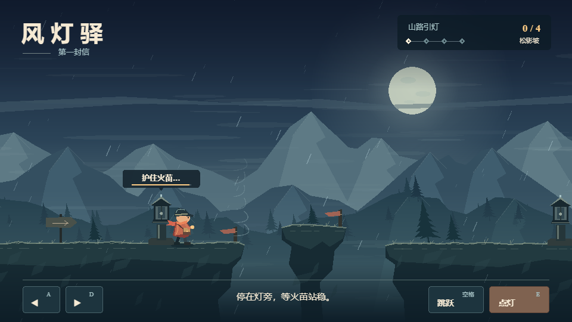

# Windlamp Post: the first 20 seconds with two agent entries

English | [简体中文](../../Cns/docs/first-playable-entry-study.md) · [Using the agent guide](agent-guide.md) · [Recordings, playable drafts and evidence](https://raw.githubusercontent.com/cnedwin/Egret_rebuild/main/guide/studies/windlamp-post/study.zip)

The updated entry produced an opening in which the courier could walk up to a lantern and attempt to light it. Rendering then stopped. The old-entry draft showed a black screen from launch. Neither draft lit a lantern or delivered the letter, and the updated-entry draft exceeded the edit budget.

## What the recordings show

| From navigation | A · old entry | B · new entry |
| --- | --- | --- |
| Before input | At 0.523 s the frame capture reported `FRAME_BUDGET_EXCEEDED`. All five sampled images were entirely black. | At 3 s the courier, an unlit lantern, a road sign and the cliffs were visible. The counter read 0/4. |
| First effective input | There was no visible target or control. The operator waited at all four slots. | At 4.003 s the operator held D for 1.5 s. The landscape scrolled, the courier moved beside the lantern and by 7 s the prompt said to hold E to light it. |
| Attempt and outcome | No playable action was observed. | At 8.000 s the operator pressed E. A flame and progress bar appeared with “护住火苗...” (“Shelter the flame”). At 8.624 s rendering reported the same error. The images at 11, 15 and 19 s were identical. D and Space produced no further visible change. The counter stayed at 0/4. |

The 19-second frames show the state each run reached.

| Old entry | New entry |
| --- | --- |
|  |  |

Both exception stacks point to the same call in the shared bundle. It charges geometry against the cumulative 65,536-triangle capture limit for one frame. Those original logs identify the budget check. The instrumented follow-up below measures the individual drawing costs. [Frame capture at the study revision](https://github.com/cnedwin/Egret_rebuild/blob/5792d800a4932da81ddf6af9314a430c41cb0f30/packages/runtime/src/sharedFrameCapture.ts#L313)

## How the drafts were made

> 做一款名叫《风灯驿》的侧视小游戏。暴风熄灭了山路的引灯，玩家要让邮差带着第一封信抵达驿站。

Both sessions received the same new request: make a side-view game where a storm has extinguished the mountain-road guide lights and the player helps a courier deliver the first letter. The controls and solution were left to the author. Both received the same HTML, starter game module, 960 × 540 logical stage and Egret 2D build from `5792d800`. Each could replace only `game.mjs`, in one response, using original procedural art. Each used `gpt-6.2-sol` with medium reasoning, without tools, external assets or execution feedback. No generated code was repaired.

A received the old `llms.txt`. B received the updated `llms.txt` and the rendered text of its two linked cards. The study tests that combined context. It did not test whether an agent would discover and open the links on its own.

The archive preserves the exact prompts. For publication, the entry uses repository-relative links, points standalone download users to the online guide and omits two headings to fit the 540-line limit. The opening advice and both cards have the same wording as in B.

| Generation | A | B | Limit per arm |
| --- | ---: | ---: | ---: |
| Author prompt, UTF-8 bytes | 33,874 | 37,294 | 96,000 |
| Elapsed seconds | 241.249 | 247.713 | 480 |
| Game source, UTF-8 bytes | 22,873 | 25,502 | 24,000 |

B exceeded the source limit by 1,502 bytes. Both original responses and their corresponding game files are retained in full.

## Reading the evidence

The signed-off input rule allowed at most one visible action at 4, 8, 12 and 16 s in a fresh browser session. The operator could map controls beforehand using only what was visible. Draft identities were concealed under random labels until the observations were written. The continuous silent clips start at navigation on Windows, Chrome for Testing 157.0.8103.6, software WebGL2, 960 × 540. Each decoded to 400 frames at 20 fps over 20.000 s. No first-time players participated. The scheduled first input gives no measure of how long a newcomer would take to understand the scene.

For the next opening, a practical acceptance check is to reach the first lantern, finish lighting it, and see that the player can continue. This pair shows why a visible first action and a complete, runnable interaction deserve separate observations. It cannot establish a repeatable quality improvement or a winner within budget.

Extract the [study archive](https://raw.githubusercontent.com/cnedwin/Egret_rebuild/main/guide/studies/windlamp-post/study.zip). In `old-entry/` and `new-entry/`, watch `first-20s.mp4` or extract `draft.zip` and serve the extracted directory over local HTTP. The archive includes the original author prompts and outputs, budgets, action logs, blinded observations, source and recording checksums, and engine notices in both drafts.

## Follow-up: what spent the triangle budget

Two diagnostic replays per original draft used its archived game bytes and a copy of its engine with counters at the existing geometry check. The second replay also counted the triangles produced by each radial fill. Both kept the 65,536-triangle limit and the original submission order. These counts describe the geometry examined by frame capture. They are not GPU draw or timing measurements.

| Draft | Geometry that accounted for the cost | First geometry refused |
| --- | --- | --- |
| A · first capture | The sky contributed 24,626 triangles and the starting cabin 16,964. The destination inn at world x = 2,411 was already attached, outside the initial 960-unit view. Its three radial glows accounted for 27,556 of its 27,716 triangles. | The inn brought the attempted subtotal from 49,664 to 77,380 in both replays. Capture stopped there. |
| B · activating the first lantern | The distant station alone held 33,593 triangles, including 33,124 from three radial fills. The first lantern went from 39 triangles to 16,421. Its newly lit radial fill generated 16,384. | An unchanged, hidden route marker cost 61. The attempted subtotal reached 65,586 and 65,590 in the two replays. The walk stopped before later effects, so their geometry is excluded from these subtotals. |

B’s game logic reached the lit state, but capture refused the frame that would have shown it. In the original recording the light counter stayed at 0/4. Looking only at the last 61 triangles would have blamed a small marker for a much larger change. The [capture code at the study revision](https://github.com/cnedwin/Egret_rebuild/blob/5792d800a4932da81ddf6af9314a430c41cb0f30/packages/runtime/src/sharedFrameCapture.ts#L1257) admits attached geometry independently of its eventual visibility.

The authoring entry now recommends simple flat layers for decorative glows, adding distant scenery as the player approaches, and reserving enough geometry for a successful action and its feedback to coexist. The third author received this general guidance. It received no case-specific counts, source from the two earlier Windlamp drafts or prescribed controls.

### Third unedited draft

The author received the original Chinese request, model (`gpt-6.2-sol`, medium), starter, engine, one-response allowance, 480-second limit and 24,000-byte UTF-8 source budget. The input was 38,135 bytes including the entry and both rendered cards. The model returned **24,387 bytes** in 257.897 seconds, **387 bytes over budget**. The entire first response went into the game unchanged.

| From a fresh launch | Reached the first lamp | Lit it | Continued after lighting |
| --- | --- | --- | --- |
| Original observation rules, four input slots | Yes. At 4.85 s the courier was beside the lamp and its E prompt was visible. The 1.5 s rightward hold carried the courier past the lamp and over the edge. | No. The courier returned to the start, where E was out of range. The counter ended at 0/3. | No. |
| Separate playable check, same game, shorter movement holds | Yes. A 0.81 s rightward hold left the courier beside the lamp. The E prompt was still visible at 7 s. | Yes. After E at 8 s, the lamp glowed, a wooden bridge appeared across the gap and the counter read 1/3 at 11 s. | Yes. After a 0.32 s rightward hold at 12 s, the courier was past the lamp at the bridge entrance. Light, bridge and count persisted at 19 s. |

Both silent videos run continuously from navigation for 20.000 seconds (400 frames at 20 fps). Both used Windows Chrome for Testing 157 with software WebGL2 and the unchanged engine, and neither reported a page exception. The second recording shows that the opening interaction works when the player stops within reach. The first records how readily the player can overshoot it. This was one generated draft and controlled browser input, with no first-time player study.

[Both videos, runnable third draft, exact prompt and response, action logs, geometry traces and replay probe](https://raw.githubusercontent.com/cnedwin/Egret_rebuild/main/guide/studies/windlamp-post/draw-budget.zip)
