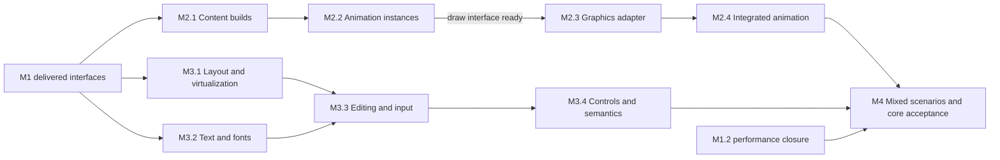

# M2–M4 architecture and community delivery plan

English | [简体中文](../../Cns/docs/m2-m4-delivery-plan.md)

2026-10-23 · Design baseline 2 · Engineering preview 0.61.0

## Purpose and current baseline

Make the existing core usable for animation-rich, complex-interface games through three outcomes: complete versioned Spine/content support, a coherent UI/text/input system, and an integrated core release with explicit evidence. This is a design and implementation roadmap, not a claim that these capabilities exist. The audience includes contributors joining without the project's conversation history.

[PR #81](https://github.com/cnedwin/Egret_rebuild/pull/81) delivered capture-record reuse and ordered preparation-key scanning at main `f9801b7bbad807c424a1ce8866487034f08706c3`. Four required CI jobs passed; the merged tree matched the reviewed candidate. M1.4 WebGL2 and M1.5 resource manifests/recovery are integrated within their documented desktop scope. The fixed M1.2 formal batch remains a valid failure: static/sparse/full-dirty Engine median-p95 is 5.0/6.4/10.3 ms against the 8 ms target. Full-dirty preparation ≤ 4 ms is not established; GPU time is unmeasured. Keep [#55](https://github.com/cnedwin/Egret_rebuild/issues/55) open.

The authoritative subsystem plans are [M2 Spine/content](m2-spine-content-plan.md), [M3 UI/text/input](m3-ui-text-input-plan.md) and [M4 core acceptance](m4-core-acceptance-plan.md). They extend the [architecture plan](architecture-and-engineering-plan.md); original contracts and failed measurements remain preserved.

## Architectural choice

| Approach | Consequence | Decision |
| --- | --- | --- |
| Grow each experiment into a separate product route | Repeats texture, scheduling and recovery ownership; makes mixed scenes difficult to reason about | Reject |
| Build complete optional subsystems over shared display/resource/rendering authority | Preserves familiar APIs and tested lifetimes while allowing internals to improve | Select |
| Replace the core and simultaneously build full 3D, native SDKs and the editor | Delays usable scenarios and discards regression foundations | Defer those product lines |

The renderers remain WebGPU plus WebGL2 with explicit capabilities; Canvas retains its limited contract. Spine does not acquire a separate GPU context. UI does not own a second asset manager. Build services do not enter runtime dependencies. New features may require reviewed internal changes to rendering, but cannot silently reinterpret old snapshots or raise existing admission limits.

## System boundaries and shared contracts

| Boundary | Producer → consumer | Decision and handoff evidence |
| --- | --- | --- |
| Source to build | Project import/build → runtime resource acquisition | Source identity, rights, importer/exporter version, target settings and transitive dependencies determine an immutable artifact identity. Rebuilds publish new generations atomically. M2 owns the artifact schema and invalidation fixtures. |
| Asset to instance | Shared decoded data and leases → animation/UI instances | Data may be shared; track state, skins, event cursors, layout, selection and interaction state belong to each instance. Scope owns cancellation and final release. M2/M3 share existing ownership semantics. |
| Instance to render | Animation sampling and UI layout → authenticated ordered frame data | Advance time explicitly once. Capture never advances time. Preserve painter/slot order; immutable retained frames cannot reference reused mutable scratch storage. M2/M3 supply public-behavior examples at the boundary. |
| Render to device | Shared preparation/residency → WebGPU/WebGL2 | Keep complete material/clip keys, bounded uploads and device generations. Resource release and native completion are different events. A new clipping path requires actual pixel and loss/recovery evidence on both declared backends. |
| Host to UI | Host pointer/keyboard/composition/fonts/semantics → UI controller | Host-specific DOM/native behavior stays in optional adapters. Core layout and events remain host-free. Late host callbacks cannot revive disposed scopes. M3 owns the input/focus/IME contract. |
| Content to tools | Stable project IDs, commands, diagnostics and build artifacts → future code/visual/Agent tools | Expose serializable intent and precise diagnostics, not native objects. Apply edits through existing transactional project authority; no model calls in frame execution. |

Retain the existing four core packages. A separately enabled Spine package may isolate the qualified third-party runtime, license and bundle boundary described in M2; it does not become a default-engine dependency. Proposed types and optional entries in subsystem plans are design targets, not current exports. A work package freezes its cross-module signature, error semantics and compatibility mapping before dependent implementation starts. Review these in the capability Issue and its plan; do not create a second global contract registry.

### Frame and replacement semantics

The target frame sequence is input/game changes → explicit animation advancement and queued events → style/measure/layout → transforms/clips → ordered capture/preparation → staged uploads → submission. User callbacks triggered during a stage are processed at a documented safe boundary, with bounded work and a diagnostic on cycles. Saved frames remain stable.

A replacement builds and validates a candidate while the prior generation remains usable, acquires the new dependencies, then commits at one frame boundary. Failure or cancellation retains the prior generation. Older requests cannot overwrite newer intent. GPU loss rebuilds device-derived state from retained or reacquired sources; it does not replay already consumed gameplay events. M2 replacement and M3 font/skin/layout invalidation test this same protocol.

### Responsibility and commitment boundaries

Keep the existing eleven work packages and their parent Issues. The role accountable for each boundary records the decision and acceptance cases in the existing package plan and Issue before a dependent implementation consumes it; no additional global freeze phase, contract registry or approval tier is introduced. A contributor may own a bounded PR within a package without owning the whole subsystem. Maintainers confirm the contributor and reviewer; the roles below do not assign volunteers.

| Boundary | Accountable package / supporting owner | Required handoff |
| --- | --- | --- |
| Animation advance, seek and event commitment | M2.2 animation maintainer; M2.1 qualifies upstream behavior | Ordinary-update failure state, replayable history and publication rules; do not assume mutable upstream state can be rolled back cheaply. |
| Spine geometry and color compatibility | M2.3 rendering maintainer with M2.2 | Ordered owned geometry and exact color/alpha semantics; extend capabilities first and version the shared protocol only for a demonstrated representation or semantic incompatibility. |
| Resource replacement | M2.4 resource/animation maintainer | Candidate readiness, resource/device generations and preserve/reset policy; no global game-clock wait for GPU recovery. |
| UI committed revision | M3.1 UI maintainer with M3.2 text and M3.3 input | Smallest coherent update domain covering layout, painting, hit geometry, focus and semantics; stale work cannot publish. |
| Alpha-mask and offscreen effects | M3.4 rendering owner with UI maintainer | Shared target/pass execution, lifetime and dual-backend references; this is an explicit renderer deliverable within M3.4. |
| Mixed scenario and measurements | M4.1 integration owner; M4.2 performance owner | One growing executable reference, exact mutation schedule and whole-engine timing; M4.3 reports only qualified scope. |

M4.1 adds animation, virtualized UI, multilingual text/input, replacement and recovery to the same example as their real interfaces become available. Early subsets expose integration and budget risks; they do not qualify the final combined profile. M1.2 retains its original failed measurements and final performance gate, without becoming a prerequisite for independent M2/M3 work or the first integration.

Authored content needs stable IDs, declarative intent and an explicit edit boundary over the existing project transaction authority. Runtime caches, native objects and transient playback state stay outside saved project data. A complete editor-wide command/undo schema is not an M3 entry requirement. Do not add arbitrary executable callbacks to persisted UI declarations.

## Delivery order and concurrency

1. Publish the contracts, fixtures and task ownership boundaries. M2 content/animation planning, M3 layout/text and M4 fixture authoring can begin without waiting for all M1 timing work. Preserve the M1 timing candidate and failed results.
2. Implement M2 and M3 along the dependencies in their plans. A contract-ready state permits work against that interface; it is not implementation acceptance. Do not merge a consumer that depends on an unavailable producer API.
3. Integrate scenarios as soon as a coherent subset runs. M4 final acceptance waits for M2/M3 required functionality, M1.2 timing closure and its declared device/material evidence. No open required row becomes a pass by moving it to another milestone.
4. Publish a scoped engineering preview if only desktop evidence exists. A stable core or device-support statement needs the corresponding complete acceptance. M4 does not certify the full product roadmap.

The sequence is dependency-based, not a staffing or calendar promise. Parallel contributions require one owner per public interface and coordination before changes to shared preparation/resource modules.

## Existing code: retain, refactor, retire

| Action | Locations and rationale |
| --- | --- |
| Retain semantics | `packages/runtime` Scope, events, display tree, asset leases, time and sequence primitives; `packages/project` transactions and strict planners. Preserve existing public behavior and failure cases. |
| Extend through shared authority | `packages/engine` shared WebGPU/WebGL2 hosts, manifest resources, page residency and staged recovery. Spine/UI submit into these paths. |
| Refactor selectively | Capture/preparation only for measured cost or a required new material/clip contract; text caches for complete paragraph/font keys; pure layout helpers into coordinated UI without removing their standalone entries. |
| Replace experiments with product adapters | Bounded Spine experiments are reference fixtures, not the shipped complete runtime. Keep original legal notices and raw evidence. Do not merely remove experiment limits. |
| Retain bounded 3D | Existing scene composition supports M4 backgrounds and depth/order regression. New mesh import, full materials, characters, world editing and general effects belong to later product work. |
| Retire only with migration evidence | A superseded preview API needs an old→new mapping, semantic differences, a runnable migration fixture and a declared removal point. Never silently break existing examples to simplify acceptance. |

## Acceptance and unresolved facts

Each work package owns a single capability contract, an executable scenario and an acceptance matrix. A row records its input/version, expected result, method, actual environment, observed result and remaining limitation. `Implemented`, `verified in this environment` and `supported` are different states.

Reuse U/A/X/L workload definitions: U has 10,000 logical/1,000 visible nodes, eight clip levels and 50,000 variable-height records; A has 20 independent Spine instances and 200 sequence instances. X selects a frozen, explicit combination rather than adding every maximum. L covers 100 enter/exit/replacement/cancellation cycles, ten actual device-loss/recovery cycles where supported and 30 minutes sustained execution. These are target fixtures, not demonstrated new capabilities.

Retain the D60 engine CPU p95 ≤ 8 ms and preparation ≤ 4 ms targets, frame-interval p95 ≤ 16.7 ms and p99 ≤ 33.4 ms. Measure GPU separately when available. Preserve five 60-second runs after 30-second warm-up, exact content/environment and all original samples. M4 defines combined scene memory, optional Spine transfer and text budgets before measurement; it cannot reuse the smaller M1 scene's memory numbers as proof for larger workloads. See each plan for its specific correctness and cancellation cases.

| Open boundary | Responsible role | Required resolution; affected claim |
| --- | --- | --- |
| M1.2 full-dirty CPU/preparation | Rendering maintainer | Measured implementation improvement and the fixed formal acceptance; blocks M1 performance/M4 core performance, not independent UI design |
| Spine version, entitlement and redistribution | Animation maintainer + release maintainer | Exact supported export/runtime identity, authorized fixtures and applicable notices; blocks unqualified complete-Spine/support claims |
| Fonts, IME, accessibility and target devices | UI/host maintainer + volunteer device testers | Licensed font corpus and real keyboard/IME/screen-reader/device runs; synthetic events cannot close those rows |
| Independent newcomer/fork | Community maintainer + a new contributor | Keep #52 open until an uninvolved person performs the public contribution flow |
| Projects board coordination | Repository/community maintainer | Access was restored on 2026-10-21; reuse the existing board and eleven Issues. Preserve history and record interface-ready separately from accepted implementation. |

## Community task structure

Keep the existing parent Issues [M2 #56](https://github.com/cnedwin/Egret_rebuild/issues/56), [M3 #57](https://github.com/cnedwin/Egret_rebuild/issues/57) and [M4 #58](https://github.com/cnedwin/Egret_rebuild/issues/58). Maintain the existing eleven child Issues, one per complete work package in the three plans. Parent Issues retain prior discussion, track dependencies and link acceptance; they are not competing implementation tasks. M0 #52/#54 and M1 #55 remain open with their real gaps.

Each child Issue contains English followed by Chinese: outcome, scope/non-goals, actual code entry points, dependencies, target interfaces, acceptance cases, current limitations and the review role. A contributor claims a task by commenting with scope and approach; maintainers confirm ownership and conflicts. Do not assign people without agreement. `help wanted` invites participation; it does not mean the architecture work is a good first issue. A newcomer can contribute an authorized fixture, a reproduction or documentation within the same package before owning the whole feature.

Use a small set of capability areas and ready/blocked labels. Ready means no unmet predecessor for the stated first deliverable; blocked names the exact predecessor or external condition. Review begins with a draft PR and concrete evidence. Done requires integrated code and that package's stated acceptance, not merely a closed PR. Dependencies in the Issue body remain readable without a Projects account.

GitHub update order: preserve current Issues/milestones → publish reviewed plans and entry links → update three parent Issues → maintain the existing eleven child packages and milestone links → mark ready/blocked from real dependencies → verify readback and consistency. Do not close historical tasks or rewrite contributor discussions to make the roadmap look simpler. Projects access was restored on 2026-10-21; maintain these same Issues and statuses in the existing board rather than creating another project.

Start from `pnpm setup:dev`, `pnpm check:quick`, and `pnpm example:browser`. Use `node tools/check-incremental.mjs --base origin/main` during work; maintainers handle current metadata integration. Final publication keeps bilingual/source checks, independent review, relevant real-browser evidence and required full merge CI. Long-run and performance evidence is required for the affected acceptance claims; documentation-only changes do not rerun graphics benchmarks. No new maintenance-automation program is part of M2–M4.

## Product continuity after M4

The all-in-one creation platform remains a later product line: coding/debugging, main canvas, UI/animation editing and publishing, plus 3D scenes/effects, worlds and characters. Its Agent harness will share project commands with manual advanced editing, support selected model APIs, Skills/MCP and plugins, and expose token accounting and configurable spending limits. M2–M4 supply stable content identities, diagnostics, transactions and replayable examples for that platform; they do not implement it or make model inference authoritative over runtime state. Complete one-click legacy migration and native/mini-game/desktop hosts remain explicit later deliverables.

## Evidence and source practice

Current claims derive from the [M1 plan](m1-rendering-resource-plan.md), [rendering evidence](incremental-frame-preparation-evidence.md), [resource recovery evidence](resource-recovery-evidence.md), [product components](product-components.md) and the actual source entries listed in subsystem plans. External mechanism/format references belong beside the relevant decision in those plans. References acknowledge technical origins; implementation remains independent except for explicitly licensed dependencies. This design was prepared with AI assistance and requires the same contributor review as other architecture changes.
