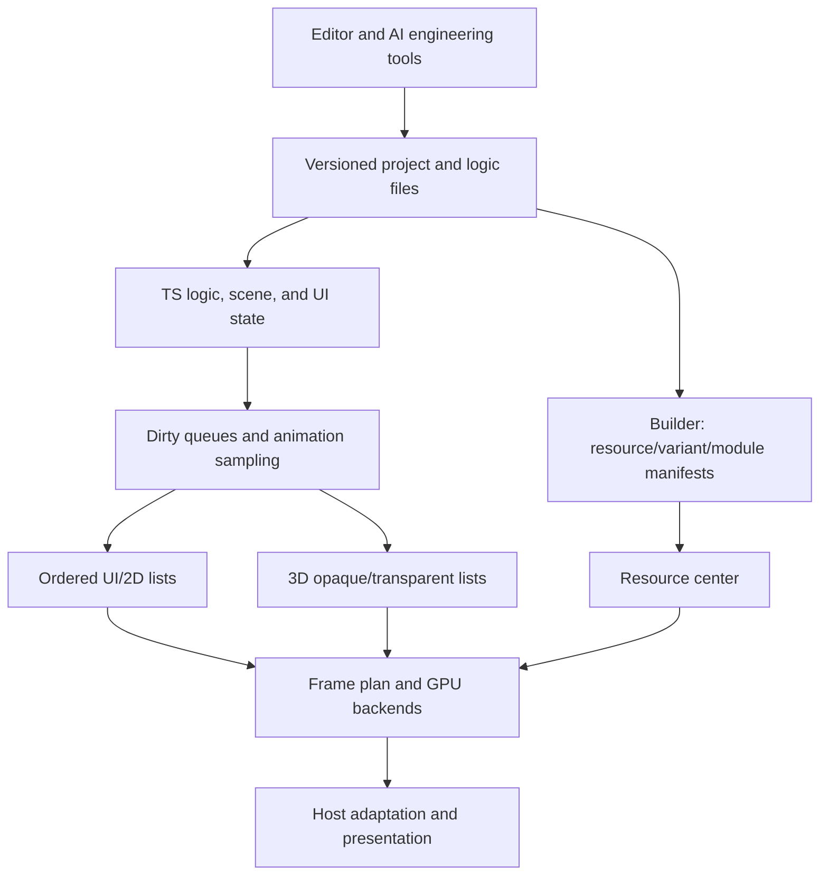

# Technical Architecture

English | [简体中文](../../Cns/docs/技术架构.md)

Egret's architecture connects an editable game project to a predictable Runtime. Project files preserve intent and stable identity; runtime instances own game state; rendering backends consume rebuildable execution data; host adapters supply platform services. These boundaries let complex 2D interfaces, animation and lightweight 3D share resources without sharing every execution strategy.

The [current core preview](core-progress.md) implements bounded parts of this direction. Complete UI, 3D, Spine, production hosts, the AI workbench and migration require their own acceptance.

[Knowledge base home](../README.md) · [Technical white paper](technical-white-paper.md) · [Product requirements](product-requirements.md) · [Engineering plan](engineering-plan.md) · [Requirements register](../../Cns/registry/需求.json) · [Decision register](../../Cns/registry/决策.json)

## Design starting point

R002 defines complex-UI 2D and lightweight-3D creation; R003 makes rendering and Runtime foundational; R004 includes scenes, characters, VFX, UI, 2D skeletal and frame animation. Content scale, target devices and launch hosts remain to be fixed. R005's loading, frame-time, memory and power goals require equivalent-workload measurement.

The design unifies project and resource contracts while organizing execution by workload. Familiar TypeScript scene and display APIs describe game semantics; compact execution data serves rendering and measured hotspots. UI ordering and layout remain explicit rather than being forced into a 3D object model. [Product components](product-components.md) defines the surrounding tool and service boundaries.

## Data authority and interface contracts

| Layer | Authority and constraints |
|---|---|
| Creation project | Project, scene, component, material, and animation schemas plus logic files are the persistence authority; saves carry versions, and stable object IDs support diffs, migration, and origin tracking. |
| Runtime state | The TS logic layer owns game state, scene changes, animation clocks, and events. Loading a project establishes initial state; temporary runtime state does not silently change the project in reverse. |
| Execution mirrors | C++/WASM/GPU hold only rebuildable projections. Layout, hit, and bounds queries should be calculated in their owning layer or returned asynchronously, avoiding bidirectional per-property synchronization. |
| Build artifacts | Content hashes, tool versions, target capability profiles, and dependency manifests determine derived resources. Caches are not authoritative and can be rebuilt if lost. |
| Host | Adapters provide surface, input/IME, clocks and presentation, audio, files/network/storage, lifecycle, and permissions. Capability detection and error classification must not masquerade as the complete browser API. |

Bridge packets must contain protocol versions, object IDs/generations, frame sequence numbers, resource readiness dependencies, and buffer ownership. Creation, updates, and destruction apply at defined frame boundaries. Old asynchronous callbacks after destruction are discarded by generation. Queues have capacity limits and backpressure; unbounded accumulation is prohibited. Overwritable state updates may be coalesced; event order must be retained. On protocol incompatibility, sequence gaps, or context loss, stop submission, rebuild mirrors from an acknowledged snapshot, and rebind resources. Recovery cannot simply ignore commands.

The resource center separately tracks download/decode artifacts, CPU data, and GPU handles, using explicit scene leases and dependency ownership. Unload first cancels tasks and removes references, then releases after GPU use completes. Asynchronous image replacement retains the old resource until the new one is ready. Loading failures need timeouts, bounded retries, placeholders, or explicit blocking. On OOM, first release rebuildable caches and reduce optional quality; if the budget still cannot be met, return a diagnosable error. Background recovery resets the clock baseline to avoid catching up an unbounded number of frames. Device loss can rebuild graphics state and should not resend consumed game events.

## AI tools and legacy-project constraints

R006's AI engineering tools work through versioned project commands, schemas, and development diagnostics, outside the per-frame rendering loop. Validate dependencies and capability requirements before changes, record origins and diffs, and generate previewable results. Failed transactions restore the original project. Natural-language suggestions cannot bypass project validation to become runtime authority directly.

R008 is already a formal requirement for the first complete release objective: [one-click AI migration of legacy projects](legacy-project-migration.md) must participate from core interface design onward. V006 ultimately depends on V001–V005. Display order, coordinates/anchors, events, timing, masks/filters, EUI, and animation semantics need mappings; compatibility modules are trimmed by dependency. Legacy projects become fixed visual, behavioral, resource, and platform regression samples. Report automatic conversion coverage and human intervention; “successful import” cannot replace “correct execution after migration.”

## Selection boundaries

TypeScript public interfaces are the main developer boundary. Optional Rust/C++, WASM and native execution are evaluated for specific end-to-end bottlenecks, including initialization, data transfer, ownership, debugging and recovery. The graphics design uses modern resource, pipeline and pass contracts; compatibility executors preserve declared semantics. Canvas remains a distinct limited profile and text/offscreen provider. Actual packages and subpaths follow the [engineering structure](engineering-architecture-and-project-structure.md), [API rules](public-api-design-and-naming.md) and [quality gates](code-standards-and-quality-gates.md).

A platform proposal requires actual SDK/device/version evidence. API availability alone cannot establish support. Initial hosts, team, schedule and numerical performance budgets remain unconfirmed. [Rendering and Runtime](rendering-engine-and-runtime.md), [advantages and verification](core-advantages-and-verification.md) and the [delivery plan](delivery-plan.md) define the corresponding acceptance work.

## Executed mature-implementation baseline

R012 supports mechanism evaluation through a replaceable reference chain, which records real use of Three r186 rendering, glTF import and animation, plus Canvas text and resource/state adaptation. Its 17/17 checks cover bounded asset sharing, independent poses, text/graphics handoff, recovery and errors; see the [adoption record](open-source-reference-implementations-and-adoption.md), [round-three integration](../archive/round-3-research.md#execution) and [audit](../archive/round-3-research.md#audit). It remains reference research with explicit third-party identity. Complete complex UI, 2D skeletons, character coverage, CJK/IME, host support and comparative benefits remain open.

## Backend and native integration

The [backend and native selection study](graphics-backends-and-native-runtime-selection.md) evaluates WebGPU/WebGL/Canvas roles, TS7, Rust/C++, VMs, native graphics libraries and possible desktop/GPU-AI extensions. Its October 8 research cutoff added no installations or executions of those candidates and no coverage beyond the separate 17-check reference chain. D013–D015 remain proposed and H008 untested at that cutoff. Later bounded browser packages do not select a native library or VM.

## Core implementation origins

R015 and the [independent implementation policy](independent-implementation-and-dependency-policy.md) require Egret's core to be authored from its own specifications. Standards and source research explain mechanisms; external libraries retain names, versions, licenses and notices. The earlier third-party chain remains separate from the independent core. AI-assisted authoring follows the same provenance, review and executable-verification requirements.

## Engineering structure and public code contracts

R016 establishes familiar Egret domain names with explicit instances, module boundaries and lifecycle contracts. D016's broader package plan remains a candidate beyond implemented packages. The [first core record](core-framework-implementation-record.md) preserves its headless cutoff, while later delivery records qualify later APIs. Complete graphics/host coverage, CI and R008/V006 migration are separate gates.

## Research basis and unresolved evidence

R011 ties decisions to progressive research and verification. The October 8, knowledge-base 0.7.0 architecture cutoff recorded D001–D016 as proposed and H001–H008 as untested; V001 research was in progress, V002 had a local headless core and V003–V006 product implementation was not started. These dated states remain historical, rather than current statements about every later package.

The [round-two execution](../archive/round-2-research.md#execution) and [audit](../archive/round-2-research.md#audit) partially verify independent event streams, per-lease resources, nested layout/hit testing, batch state and procedural WebGL scenes. The [round-one execution](../archive/round-1-research.md#execution) and [research review](../archive/round-1-research.md#research) remain separate. They do not cover complete assets, font/skeletal semantics, real JS/WASM/C++ bridges or device budgets.

Historical Runtime review observed binary command bridging, retained trees, adjacent-texture batching and dirty caches. Buildability and platform performance were not established. It also found disabled certificate verification in historical networking code; any reuse requires secure-default review and correction.

Versioned comparison references include [Cocos JSB transfer costs](https://docs.cocos.com/creator/3.8/manual/en/advanced-topics/jsb-optimizations.html), [Cocos 3.8 pipeline migration](https://docs.cocos.com/creator/3.8/manual/zh/render-pipeline/overview.html), [LayaAir 3.3.0 release](https://github.com/layabox/LayaAir/releases/tag/v3.3.0) and [Godot 3→4 migration](https://docs.godotengine.org/en/4.7/tutorials/migrating/upgrading_to_godot_4.html). The research retains Laya 3.3/3.4 source-date conflicts and un-rechecked IDE/old-site dates. These describe particular mechanisms and upgrade constraints; they establish no current speed ranking.

The original V008 artifact was the 0.6 candidate white-paper/PRD/engineering-plan package. It was document delivery rather than complete product implementation.
