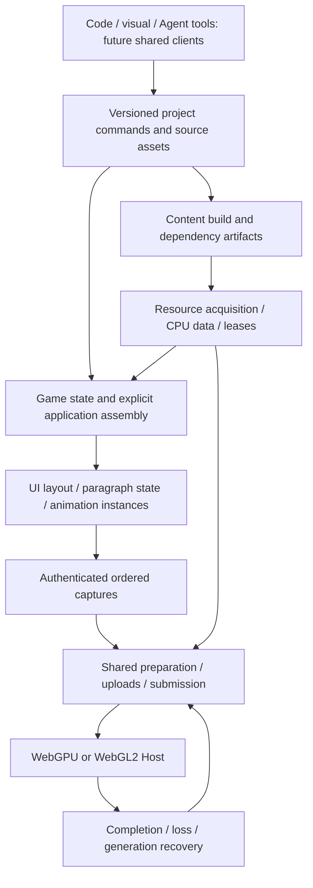

# Technical white paper

English | [简体中文](../../Cns/docs/技术白皮书.md)

Architecture reviewed on 2026-11-14 at main [06182ab](https://github.com/cnedwin/Egret_rebuild/commit/06182ab8e6dadbb7a670e10a2d798bea72f5ee39). [Current capabilities](core-progress.md), [product requirements](product-requirements.md) and the [engineering plan](engineering-plan.md) separate runnable behavior, required acceptance and future work.

## Product and architectural direction

Egret serves creators building games with AI assistance and developers who need understandable code, predictable runtime behavior and integrated tools. Its differentiating target is a small Web-first core that can combine complex 2D UI, animation and lightweight 3D, then support natural-language, visual and code editing of the same project. Low loading cost, sustained responsiveness and controlled resource use are design goals that require actual equivalent-workload measurements.

The chosen foundation is TypeScript game semantics over shared rendering and resource authority, with optional specialist providers. SharedFrame2D uses WebGPU and WebGL2 as its current browser execution paths. Canvas-based providers supply text and images. WASM/native code enters a measured specialist or host boundary; neither a language rewrite nor an API name establishes a performance advantage.

Four foundation packages are implemented: contracts, runtime, engine and project. A fifth optional Spine package isolates the explicit upstream runtime and its license. Graphics and browser-host code currently live inside engine. Separate graphics/hosts/toolchain/CLI packages, Rust crates and editor applications remain possible later organizations, not prerequisites or existing public APIs.

## One project, distinct state authorities

The diagram describes responsibility boundaries. Current project transactions and runtime APIs exist; the complete project-to-game compiler and integrated tool clients do not.

Persistent project IDs, editable assets and revisions belong to project services. Game values, display hierarchy, animation state and consumed events belong to the application/runtime. CPU caches and GPU objects are derived state. Native pointers, cache entries and display-object addresses never become persistent project identity.

Display parentage is distinct from disposal and asset ownership. Scope cancels demand and owns cleanup; resource leases keep shared data alive independently. The Host alone establishes native completion and retirement. An object being unreachable from the display tree does not prove its data or GPU allocation is retired.

## Shared frame execution

The integration sequence is input/game actions → explicit game-time and animation advancement → style/measure/layout → transforms/clips → ordered capture/preparation → bounded resource upload → submission. Existing public APIs make those operations explicit; this sequence does not imply an unimplemented automatic Engine update or editor scheduler.

Capturing a frame does not advance animation. User mutations and callbacks must enter documented safe boundaries, with cancellation, reentry and cycle errors remaining observable. A saved frame retains owned immutable data after scratch storage, source instances or device generations change.

Transparent UI, Spine slots and effects retain authored order. Only adjacent compatible commands may batch; complete keys include target, material, texture/sampling, blend/color and clipping. Opaque 3D may use separate depth/material ordering within its declared contract. Sorting all textures together would change the game.

Incremental capture/preparation and completion-safe buffer/texture reuse are implemented. New optimization must show which work it removes on the actual workload and preserve full-path comparisons. Static reuse counters are correctness evidence, not a replacement for whole-engine timing.

## Rendering, color and effects

The shared WebGPU/WebGL2 paths use common admitted geometry and resource semantics while each backend owns its actual objects, commands and generation. Required capabilities are checked before publication. Unsupported effects cannot silently disappear during fallback.

Texture pages preserve crop, trim, rotation, logical size and sampling identity. Color space, straight/premultiplied alpha and blend equations are explicit profiles. Spine's egret-shared-linear/1 connection is not a promise of legacy gamma-space equivalence or every upstream renderer profile.

Shared Alpha masks and bounded separable offscreen blur already use the same render/resource lifetime. Targets and scratch work are bounded by pixel extent and overlap, not merely object count. UI supplies effect parameters and invalidation; the renderer supplies target reuse, pass ordering, completion and recovery. A general shader graph is not required for the present core.

The Canvas Host was retired. Its historical observations remain bound to their original build. Current 2D drawing uses SharedFrame2D. WebGL1, native graphics libraries and cross-API sharing require separately selected hosts and qualification.

## Resources, content and replacement

The content chain is source assets → versioned importer/build → immutable artifacts/dependencies → manifest admission → shared providers/leases → instances → captured rendering. Stable source identity differs from build identity, runtime resource generation and device generation.

Selected PNG, atlas, multipage, sequence and font builds and their runtime groups are implemented. Spine JSON assets use the optional integration. Binary Spine products, compressed/mip target variants and complete exporter compatibility remain work in M2.1. Build tools do not enter the default game loop.

Network, decode, semantic construction, CPU publication and device upload have separate readiness and capacity. A cancelled consumer releases only its demand; actual unfinished work remains accounted until settlement. Late results cannot restore a disposed Scope or overwrite newer intent.

Existing Bitmap, sequence and Spine replacement contracts keep the prior active generation while preparing a candidate. RESET is explicit: it is not compatible preservation of arbitrary playback state. A state-preserving successor must define identity/name compatibility, time/tracks/skins/events and a refusal policy before commitment. GPU loss rebuilds device-derived state without replaying consumed gameplay events.

## Complex UI, text and input

Managed UI owns coherent revisions of measurement, placement, painting and interaction geometry. The smallest update domain includes dependent ancestors, siblings, popup anchors and focus/editor state when required. Pending or failed asynchronous work preserves its preceding commit; unrelated domains remain usable.

Variable-height virtualization uses stable business keys, a height index, bounded visible/overscan rows and anchored scrolling. Focused/composing rows need a separately bounded retention policy. Row recycling terminates old bindings before reuse; old asynchronous text or skin results cannot populate another record.

Readonly paragraphs already use a host-injected CanvasKit/SkParagraph provider with explicit font bytes, styled runs and final-line bidi. Committed hit, selection and caret geometry comes from the same native layout and raster result. Font generation and provider identity participate in cache keys. T1/TF1/WC1 compatibility entries retain their original scope.

The earlier ICU/HarfBuzz/FreeType proposal is realized through the selected provider integration; it is not an instruction to build another paragraph engine. Private Unicode/bidi comparisons retain their exact source and conformance boundaries. Required independent script/font/ink references, provider transfer/startup costs and complete memory qualification remain open.

Managed single-line and multiline editing use native browser fields for composition and selection. The Engine owns committed values and publishes them through paragraph/UI layout with explicit reflow and anchor tolerances. The optional canvas adapter places a platform field above a game surface and returns committed text to the application. Real IME and accessibility qualification remain open for their respective paths. [Managed editing](native-text-editing.md) · [Canvas text input](text-input.md)

Mouse compatibility, multi-contact routing, keyboard/focus and contributed movement/action state exist. Gesture/control wiring, popup/modal arbitration, semantic projection and real IME/accessibility acceptance remain separate. Picking consumes committed geometry, never inferred glyph widths or GPU pixels. The existing touch contributor keeps that implementation scope.

## Spine and 3D

The optional Spine package uses official Core 4.3.13 for semantic computation and first-party Egret assets, instances, scheduling, geometry, RESET and recovery integration. Its actual version is not a latest-release claim. Runtime redistribution conditions and fixture rights are separate from Egret's Apache-2.0 license.

Independent playback, combined skins, finite plays and ordered shared graphics are implemented. Complete selected-version support still needs the applicable attachment/constraint/physics/timeline/blend/reference matrix, binary admission, seek/replay and compatible replacement. Programmatic fixtures and two adapters sharing the same Core cannot independently certify all authored animation semantics.

Optional World3D supplies standalone WebGPU and WebGL2 rendering, glTF, materials, skinned animation, effects and preview physics. The earlier scene3d Host is historical. Authoring and equivalent mixed-scene composition with SharedFrame2D remain work under M4. [World3D contract](world3d.md) · [M4 plan](m4-core-acceptance-plan.md)

## Hosts, recovery and native Runtime

Browser hosts own surfaces, presentation and optional input/font/network adapters. Shared recovery separates resource-ready, fresh-generation display-ready and interactive-ready. A visible restored frame alone does not establish restored gameplay or input.

Desktop and bounded Android results are available in their [evidence](android-device-validation.md). They do not certify spontaneous driver failure, OS process death, every phone, mini-game SDK or native app. WeChat, Douyin, Instant Games, Discord and Telegram each require their actual container/service/lifecycle and distribution checks.

A future native App/embedded SDK must combine graphics, one selected JS VM, fonts, input, audio/storage/lifecycle and debugging. Rust/C++ and wgpu/Dawn remain evaluated module/provider choices; replacing the complete TypeScript core is not planned as an automatic performance fix. Steam/desktop graphics and GPU-assisted AI remain extension directions with their own device, latency and quality evidence.

## Creation platform and migration

The all-in-one platform retains coding/debugging, main canvas, UI/animation editing and publication, and adds 3D scene/effect, world and character editing. Tools may share surfaces when that improves a workflow. Natural-language and manual advanced editing operate on the same versioned project and visible diff/undo semantics.

An external Agent harness will support user-selected model APIs, Skills, MCP tools and plugins, with visible token consumption and configurable cost limits. Model credentials, calls and billing stay outside frame execution. Existing project transactions are a foundation, not a completed Agent service or editor.

Legacy migration remains a full product obligation: preserve a runnable old baseline, inventory dependencies, apply deterministic conversion then bounded Agent repair, compare behavior/graphics/events/resources/platforms, and continue editing, publishing and updating the new project. Current RES/MovieClip planners are prerequisites, not one-click whole-project migration.

## Measurement and delivery

The later E20 desktop run measured 5.3 ms full-dirty Engine median-p95 against 8 ms and met the preparation bound. Sparse/full-dirty wall-gap p95 was 17.2/17.3 ms against 16.7 ms. E20 did not measure GPU time. [#55](https://github.com/cnedwin/Egret_rebuild/issues/55) M4's whole-engine span includes input, animation/events, layout, capture, preparation and synchronous submission; phase p95 values cannot be summed into a whole-engine p95.

Measure actual cold transfer, required provider/font initialization, first interaction, sustained frame tails, replacement peaks and cleanup. The approximately 25.85 MB raw paragraph payload recorded at an earlier checkpoint is not its compressed transfer or complete X budget. M4 must bind the adopted provider and actual assets before formal collection; original targets cannot be silently relaxed.

Logical leases, JS heap, WASM capacity, backing storage, GPU counters and physical RAM/VRAM are different domains. The Android follow-up demonstrates why cached performance.memory cannot be read as a live pure-JS heap curve. Controlled loss, diagnostic GC and short callback sampling retain their limits.

Work proceeds in complete behavior packages: concentrated implementation, one affected verification pass, independent source/results/bilingual review, normal hooks and complete protected merge checks. Reuse evidence only after comparing its actual inputs. Full milestone/device/performance claims need their own required results.

## Sources and continuity

Current contracts and source records identify independently authored Egret code, adopted dependencies and their notices. [Research rounds one](../archive/round-1-research.md), [two](../archive/round-2-research.md) and [three](../archive/round-3-research.md) retain original mechanisms, failures and audits; they are not current product acceptance. The [previous white paper](https://github.com/cnedwin/Egret_rebuild/blob/f869b3733366d1fea0c71adba2cdc3ea03fe7ba1/knowledge-base/en/docs/technical-white-paper.md) preserves earlier design alternatives and dated observations.

See the [architecture plan](architecture-and-engineering-plan.md), [M2–M4 roadmap](m2-m4-delivery-plan.md), [implementation/dependency policy](independent-implementation-and-dependency-policy.md) and [source ledger](https://github.com/cnedwin/Egret_rebuild/blob/main/source-origin.json). This review changes no raw evidence, upstream license, package dependency or engine behavior.
